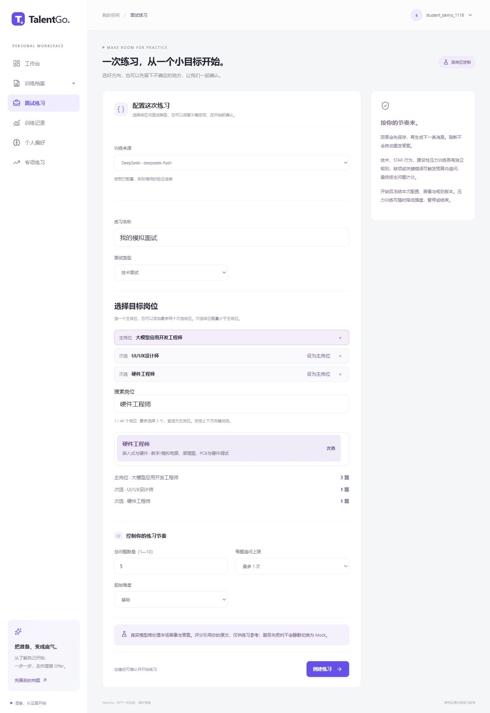

# TalentGo · 你的面试成长空间

面向计算机科学、软件工程与人工智能专业学生的实习与校招文字面试训练项目。

**当前版本 v0.6.0，支持 PC 端账号注册、48 个岗位搜索与主次岗位面试。已根据首轮试用加入分轮计时、精简题干和改进阶段反馈。**

PC 界面已统一为白色到深紫色的五级渐变，加入页面进入、悬浮与点击反馈，以及可记住状态的折叠侧边栏；展开时带轻微回弹。[界面调整说明与实际截图](docs/界面主题与交互调整.md)。

登录与注册现在分别位于独立的 `/login`、`/register` 页面，未登录先进入登录页。账号及训练数据持久存入 PostgreSQL；7 天仅为登录凭证有效期，到期重新登录即可。已修复 Edge 的 DNT 跨域预检问题，本地默认使用 `/api/v1` 同源代理，并移除首页“空间运行状态”卡片。[登录修复说明](docs/登录修复与独立账号页面.md)。

训练档案支持保存一个主岗位和最多两个次选，新建练习自动带入。[界面精简与次选岗位](docs/界面精简与次选岗位修复.md)

新建练习默认每轮 2 分钟，主问题与追问分别计时。真实模型分别显示评估和出题进度，页面内容依次淡入。当前迁移为 `0007_question_answer_clock`，数据库端口为 6543。[使用说明](docs/使用说明.md)

## 当前能力

- Vue 工作台、账号密码注册/登录/退出与独立训练档案，PostgreSQL **6543** 持久化。
- 覆盖 48 个岗位，支持搜索滚动选择，一个主岗位加最多两个次选，整场题量按主次分配；技术/行为/压力三类训练及完整会话控制。
- 技术深挖、行为 STAR、建设性压力、证据复盘四 Skill；新增岗位由模型实时出题及生成本题评价要点，原参考锚点兼容保留。
- DeepSeek 真实模型和明确标记的 Mock 独立选择。Mock 不计能力分，服务失败不静默回退。
- 五维结构与原文引用校验、一次受控修复；后端 Decimal 计算主问题最终成绩，追问不重复计权。
- 报告显示覆盖、每题理由/缺口/建议、用户原文定位、模型与规则版本、Skill 阶段和实际用量。
- 已保存回答与正式状态可刷新恢复；幂等回执、版本冲突和取消防止重复或迟到结果覆盖。

M4 新增记忆确认、修改及删除、最多八条相关注入、旧结果失效、主题摘要、来源复练与完成判定、版本分组评分。入口为 /memories（个人偏好）与 /growth（专项练习）。工程回归包含 30 个预设对话场景。模型分数仅供训练参考。

## 本地启动

需要 Windows PowerShell、Python 3.12/3.13、Node ≥22.12、已启动的 Docker Desktop。根目录执行：

```powershell
./scripts/setup.ps1
```

脚本保留已有配置与数据库卷，创建缺失的随机本机密码、安装锁定依赖、启动 db、升级开发库并创建独立测试库。不要将样例密码原样使用，不要为升级删卷。

在 backend/.env 配置真实模型：

```dotenv
LLM_PROVIDER=deepseek
LLM_API_KEY=仅在本机填写实际密钥
LLM_BASE_URL=https://api.deepseek.com
LLM_MODEL=deepseek-flash
```

Key 不入 Git；修改配置后重启后端。默认新环境不设 Key 时仍可使用 Mock。“已配置”仅表示本机有值，实际调用才验证密钥、余额与服务。官方参数参考 [DeepSeek Chat Completions](https://api-docs.deepseek.com/api/create-chat-completion/)，配置细节见 [环境说明](docs/环境配置说明.md)。

```powershell
# 终端一
./scripts/start-dev.ps1
# 终端二
./scripts/start-dev.ps1 -Service frontend
```

| 入口 | 地址 |
|---|---|
| 工作台 | http://127.0.0.1:5173 |
| 档案 | http://127.0.0.1:5173/profile |
| 面试配置 | http://127.0.0.1:5173/practice |
| 训练记录 | http://127.0.0.1:5173/history |
| API 文档 | http://127.0.0.1:8000/docs |
| 数据就绪 | http://127.0.0.1:8000/api/v1/health/ready |
| PostgreSQL | localhost:6543；开发库 talentgo，测试库 talentgo_test |

Compose 只管理 db，前后端为本机进程，服务仅回环开放。执行器每库仅允许一个后端进程，不能多 workers；中断操作启动后明确标失败，再由用户重试，不是分布式任务队列。

## 账号与多岗位更新（v0.6.0）

- 右上角账号密码登录或注册；本地普通测试账户 **admin / password**，不拥有其他账号的数据权限。
- 搜索 48 个岗位，最多选择 3 个；5 题可分配 3/1/1，4 题分配 2/1/1，次选题量少于主岗位。
- 题目、评价、相关偏好、专项练习和导出保留实际岗位；不同主次组合分开显示趋势。
- 新 Prompt 1.3、rubric 1.1；数据库迁移至 0005_accounts_roles，旧记录保留。
- 页面移除阶段验收用词和旧匿名演示身份恢复；升级及验证见 [本轮报告](docs/账号与多岗位升级报告.md)。

## M5 历史变化

- 完成 30 个可重复场景和 141 项工程测试；真实模型子集另行记录，不当作人工评测。
- 报告底部可导出 Markdown/JSON，保留来源、原文证据、版本与覆盖；Mock 始终不计能力分。
- 新规则 prompt-1.2 / rubric-1.1：仅切题与表达有分时不生成内容总分。旧报告保留，旧来源任务不悄悄迁移。
- 操作生命周期首事件/首可见字/完成时延，以及供应商首 content、cache 用量均可核对；未知不补零。
- 仅验收 PC 端，详见 [M5 阶段报告](docs/M5阶段报告.md)。

## 验证与展示

```powershell
# 固定夹具与隔离测试库，不调用外部模型
./scripts/check.ps1
# 显式真实子集：10 语义案例 + 4 API 闭环，通常约 22 次模型请求，另有有限格式修复
./backend/.venv/Scripts/python.exe scripts/run-m5-live.py --live --include-backend
```

历史 M3 工程与真实模型检查见 [M3 阶段报告](docs/M3阶段报告.md)；M5 历史结果见 [M5 阶段报告](docs/M5阶段报告.md)，当前变更见 [账号与多岗位升级报告](docs/账号与多岗位升级报告.md)。按用户要求，原两人人工填写改为模型辅助评估，结果在 tests/fixtures/m3-model-assisted-review.json。13 份均已填写，实际人工评阅为零，不能充当人评准确率或真实用户试用。M4 实施与验证见 [M4 阶段报告](docs/M4阶段报告.md)。



## 目录与说明

- frontend：Vue 3、TypeScript、Vite、Pinia、Element Plus、Lucide。
- backend：FastAPI、Pydantic、SQLAlchemy、psycopg、HTTPX、轻量 Skill 编排。
- database：五次增量 Alembic 迁移，16 张业务表。
- scripts：环境、启动、检查、备份及显式真实模型验证。
- docs：[总览](docs/项目文档.md)、[完整开发计划](docs/项目开发计划.md)、[架构](docs/架构设计.md)、[接口](docs/接口文档.md)、[数据库](docs/数据库设计.md)、[评分](docs/Skill与评分设计.md)。

依赖锁为 backend/uv.lock、frontend/package-lock.json。真实 .env、凭证、虚拟环境、备份及 .runtime 不上传。登录后浏览器只保存当前会话 token，密码不保存；清除浏览器数据可用账号密码重新登录。本项目范围仍为本地 PC 测试，尚不包含账号找回或公网部署。
