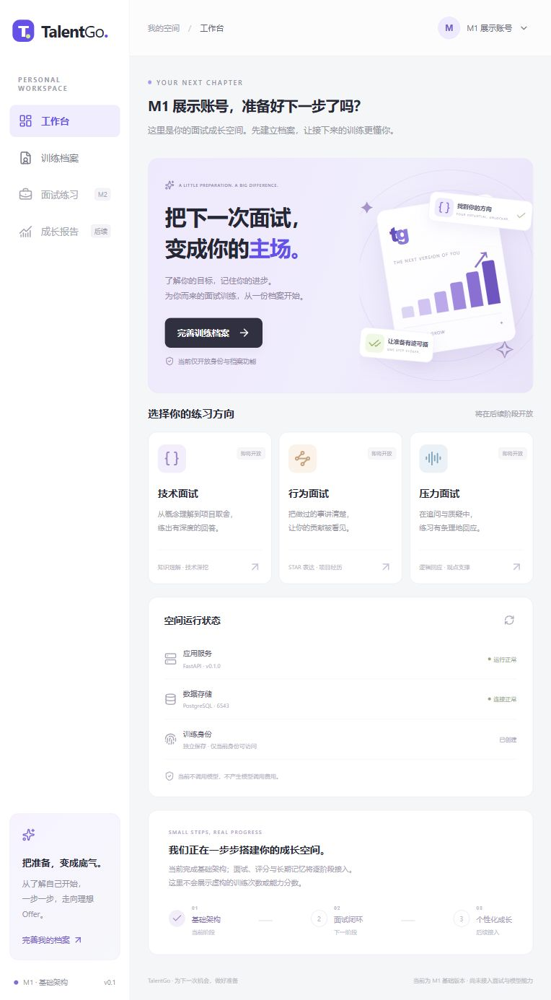

# TalentGo · 你的面试成长空间

面向计算机专业学生的软件开发实习与校招训练项目。

**当前完成 M1：可运行基础；完成后停在 M1，M2 尚未开始。**

## 当前能力

- Vue 工作台与训练档案页面，显示真实后端/数据库健康状态。
- 匿名训练身份创建、浏览器内切换、令牌校验；数据库仅存令牌哈希。
- 保存目标岗位、经验阶段、技术栈、背景、目标与反馈偏好，刷新仍可读取。
- 后端身份隔离、乐观锁、幂等回执及并发冲突处理。
- PostgreSQL **6543**、首个 Alembic 迁移、独立测试库、前后端依赖锁及 Windows 脚本。

面试、模型、评分、长期记忆和成长报告留到后续阶段；界面明确标记尚未开放，不展示虚构训练数据。

## 本地启动

需要 Windows PowerShell、Python 3.12/3.13、Node ≥22.12、已启动的 Docker Desktop。在项目根目录执行：

```powershell
./scripts/setup.ps1
```

脚本保留已有配置，创建缺失的本地 .env 与随机数据库密码，安装锁定依赖、启动专属数据库、迁移开发库并创建独立测试库。样例密码不能原样使用。

两个终端分别运行：

```powershell
# 终端一
./scripts/start-dev.ps1
# 终端二
./scripts/start-dev.ps1 -Service frontend
```

| 入口 | 地址 |
|---|---|
| 工作台 | http://127.0.0.1:5173 |
| 档案 | http://127.0.0.1:5173/profile |
| API 文档 | http://127.0.0.1:8000/docs |
| 数据层就绪 | http://127.0.0.1:8000/api/v1/health/ready |
| PostgreSQL | localhost:6543；开发库 talentgo，测试库 talentgo_test |

Compose 当前只管理 db，前后端为本机进程；所有服务仅回环地址开放。普通停止保留数据库卷，不要删卷。服务端以 postgres -p 6543 启动，已实际查询 SHOW port 验证。

## 检查与展示

```powershell
./scripts/check.ps1
```

15 项后端测试通过；前端类型检查及生产构建通过；测试库升级—降级—升级与 ORM 差异检查通过；浏览器实际验证创建、保存与刷新。详见 [M1 阶段报告](docs/M1阶段报告.md)。



## 目录与文档

- frontend：Vue 3、TypeScript、Vite、Pinia、Element Plus、Lucide。
- backend：FastAPI、Pydantic、SQLAlchemy、psycopg。
- database：Alembic；M1 先建 users、profiles、idempotency_receipts。
- scripts：环境、启动、检查、备份；tests：后续对话场景占位。
- docs：[文档总览](docs/项目文档.md)、[开发计划](docs/项目开发计划.md)、[架构](docs/架构设计.md)、[接口](docs/接口文档.md)、[数据库](docs/数据库设计.md)。

依赖锁为 backend/uv.lock、frontend/package-lock.json；后续功能文件保留空占位且未注册。真实 .env、虚拟环境、备份、运行产物均忽略，不上传 GitHub。

匿名身份原始令牌保存在当前浏览器，遗失不可找回。本地 Docker 初始化角色具备开发管理权限，公开部署前需角色拆分、HTTPS、限流与身份恢复。本轮没有调用大模型，没有真实用户试用结论。
