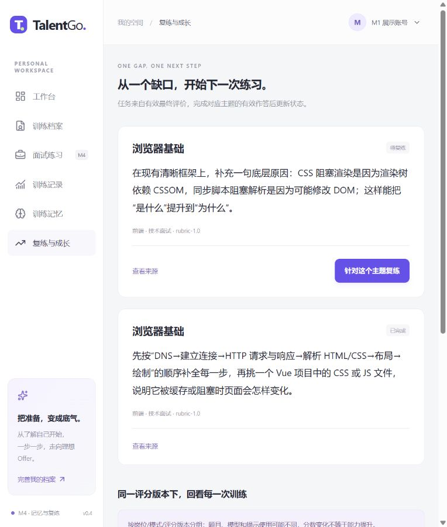

# TalentGo · 你的面试成长空间

面向计算机专业学生的软件开发实习与校招文字训练项目。

**当前为 M4：长期记忆、来源复练和版本分组评分记录已接入。停在 M4，M5 未开始。**

## 当前能力

- Vue 工作台、匿名身份与训练档案，PostgreSQL **6543** 持久化；资料/会话按身份隔离。
- 配置前后端岗位、技术/行为/压力模式，真实语义澄清、完整问答、追问/提示/跳过、暂停/恢复、停止/重试。
- 技术深挖、行为 STAR、建设性压力、证据复盘四 Skill，40 个项目自写种子题与题目锚点。
- DeepSeek 真实模型和明确标记的 Mock 独立选择。Mock 不计能力分，服务失败不静默回退。
- 五维结构与原文引用校验、一次受控修复；后端 Decimal 计算主问题最终成绩，追问不重复计权。
- 报告显示覆盖、每题理由/缺口/建议、用户原文定位、模型与规则版本、Skill 阶段和实际用量。
- 已保存回答与正式状态可刷新恢复；幂等回执、版本冲突和取消防止重复或迟到结果覆盖。

M4 新增记忆确认/纠正/删除、最多八条相关注入、旧结果失效、主题摘要、来源复练与完成判定、版本分组评分。入口为 /memories 与 /growth。完整场景回归、真实用户验证分别在 M5/M6。模型分数仅供训练参考，不能核实经历、诊断心理或预测录用。

## 本地启动

需要 Windows PowerShell、Python 3.12/3.13、Node ≥22.12、已启动的 Docker Desktop。根目录执行：

```powershell
./scripts/setup.ps1
```

脚本保留已有配置与数据库卷，创建缺失的随机本机密码、安装锁定依赖、启动 db、升级开发库并创建独立测试库。不要将样例密码原样使用，不要为升级删卷。

在 backend/.env 配置真实模型：

```dotenv
LLM_PROVIDER=deepseek
LLM_API_KEY=仅在本机填写实际密钥
LLM_BASE_URL=https://api.deepseek.com
LLM_MODEL=deepseek-flash
```

Key 不入 Git；修改配置后重启后端。默认新环境不设 Key 时仍可使用 Mock。“已配置”仅表示本机有值，实际调用才验证密钥、余额与服务。官方参数参考 [DeepSeek Chat Completions](https://api-docs.deepseek.com/api/create-chat-completion/)，配置细节见 [环境说明](docs/环境配置说明.md)。

```powershell
# 终端一
./scripts/start-dev.ps1
# 终端二
./scripts/start-dev.ps1 -Service frontend
```

| 入口 | 地址 |
|---|---|
| 工作台 | http://127.0.0.1:5173 |
| 档案 | http://127.0.0.1:5173/profile |
| 面试配置 | http://127.0.0.1:5173/practice |
| 训练记录 | http://127.0.0.1:5173/history |
| API 文档 | http://127.0.0.1:8000/docs |
| 数据就绪 | http://127.0.0.1:8000/api/v1/health/ready |
| PostgreSQL | localhost:6543；开发库 talentgo，测试库 talentgo_test |

Compose 只管理 db，前后端为本机进程，服务仅回环开放。执行器每库仅允许一个后端进程，不能多 workers；中断操作启动后明确标失败，再由用户重试，不是分布式任务队列。

## 验证与展示

```powershell
# 固定夹具与隔离测试库，不调用外部模型
./scripts/check.ps1
# 显式真实调用：3 个合成一题会话，通常约 9 次请求，另有有限格式修复
./backend/.venv/Scripts/python.exe scripts/smoke-model.py --live
```

本轮工程检查、三类真实一题闭环、小样本重复和注入观察详见 [M3 阶段报告](docs/M3阶段报告.md)。按用户要求，原两人人工填写改为模型辅助评估，结果在 tests/fixtures/m3-model-assisted-review.json。13 份均已填写，实际人工评阅为零，不能充当人评准确率或真实用户试用。M4 实施与验证见 [M4 阶段报告](docs/M4阶段报告.md)。



## 目录与说明

- frontend：Vue 3、TypeScript、Vite、Pinia、Element Plus、Lucide。
- backend：FastAPI、Pydantic、SQLAlchemy、psycopg、HTTPX、轻量 Skill 编排。
- database：四次增量 Alembic 迁移，15 张业务表。
- scripts：环境、启动、检查、备份及显式真实模型验证。
- docs：[总览](docs/项目文档.md)、[完整开发计划](docs/项目开发计划.md)、[架构](docs/架构设计.md)、[接口](docs/接口文档.md)、[数据库](docs/数据库设计.md)、[评分](docs/Skill与评分设计.md)。

依赖锁为 backend/uv.lock、frontend/package-lock.json。真实 .env、凭证、虚拟环境、备份及 .runtime 不上传。匿名身份令牌只保存在当前浏览器，遗失不可找回；本地数据库角色有开发管理权限，公开部署前仍需身份恢复、角色拆分、HTTPS 与限流。
