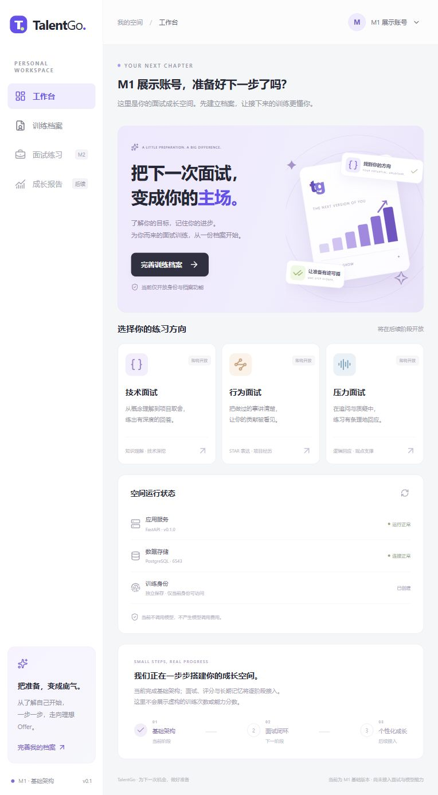
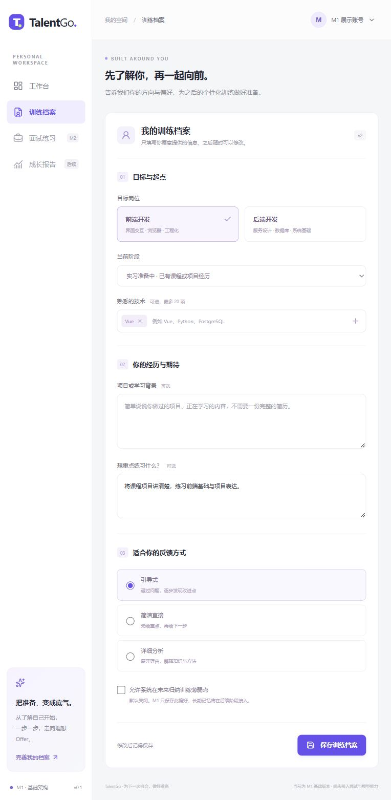

# M1 阶段报告 · 可运行基础

日期：2026-11-13，Asia/Shanghai。项目名称 TalentGo，工作区 `D:\计算机前沿技术\hf\TalentGo`。本轮只执行 M1，**M2 尚未开始**。

## 1. 完成的行为

- 前端工作台：TalentGo 品牌、训练方向预告、真实服务/数据库状态；没有虚构练习记录或能力分数。
- 训练档案：匿名昵称身份创建、同浏览器多个身份切换、资料编辑、保存、刷新恢复；遗失浏览器令牌不可找回。
- FastAPI：仅注册 live/ready、创建/读取身份、读取/更新档案六个端点，提供 OpenAPI。
- 安全边界：Bearer 身份哈希存储、当前身份过滤、禁止客户端 user_id、输入校验、统一错误/request_id、no-store、限定 CORS。
- 并发与保存：资料 version 乐观锁；请求键哈希回执；同键重试回放、不同内容冲突、并发单次更新。
- 数据：专属 Docker PostgreSQL，实际监听和宿主映射均为 **6543**；开发库 talentgo、测试库 talentgo_test。
- 迁移 0001_m1_foundation：users、profiles、idempotency_receipts，加 alembic_version；后续面试实体暂不建表。
- 工程：.gitignore、环境样例、本地随机密码配置、uv/package-lock 依赖锁、安装/启动/检查脚本及保留文档更新。

## 2. 实际检查

| 检查 | 实际结果 |
|---|---|
| npm run build | 通过，包含 vue-tsc 类型检查与 Vite 生产构建 |
| 后端 pytest | **15 passed**：13 个集成案例、2 个规则案例 |
| 身份隔离 | A 修改后 B 的资料保持独立；越权字段拒绝、无效/撤销令牌拒绝 |
| 幂等与并发 | 同键同输入回放，异内容 409；并发同键仅一次变更，异键同版本仅一个成功 |
| 资料边界 | 长度、空值、角色、版本、未知字段校验通过 |
| 迁移 head | 0001_m1_foundation；readiness 检查通过 |
| PostgreSQL SHOW port | **6543** |
| Alembic check | No new upgrade operations detected |
| 测试库降级/升级 | 降到仅 alembic_version，再升回三张业务表；元数据一致 |
| scripts/check.ps1 | 实际运行通过：pytest、迁移差异与前端构建 |
| PowerShell 脚本语法 | 解析通过；setup 全新机器安装与备份恢复未做完整演练 |
| 浏览器人工检查 | 创建 M1 展示账号→填写前端/实习/Vue/目标→保存→刷新，version=2，内容保留 |
| 秘密排除 | 本地 .env、虚拟环境、工具与依赖在忽略范围，推送前检查暂存清单 |

pytest 有一个第三方警告：Starlette 对 httpx TestClient 适配发出弃用提醒，当前锁定环境下 15 项均通过；未屏蔽警告，也未将其记录为产品故障。uv Python 模块引导可能提示虚拟环境路径不同，但实际使用 backend/.venv，未修改系统环境。

早期前端构建的 option 标签错误已修正，并重新构建通过；迁移验证命令的初次导入路径问题已修正后重跑通过。不会将失败尝试写成首次即成功。

## 3. 本地展示

- 工作台：http://127.0.0.1:5173
- 档案：http://127.0.0.1:5173/profile
- API：http://127.0.0.1:8000/docs
- 后续重启：两个终端分别执行 scripts/start-dev.ps1、scripts/start-dev.ps1 -Service frontend。

截图使用浏览器原有视口，没有伪造 UI。展示账号是本轮开发检查产生的本地资料，不是课程真实用户试用；未保存或提交原始令牌、数据库密码。

## 4. 未做与限制

没有面试闭环、对话生成、四 Skill、真实模型、评分、SSE、长期记忆、报告或复练。保留的相关源码、Prompt、题库与场景文件仍是未接入占位，不能按已实现统计。未执行 30 个对话场景或四名真实用户测试。

没有公开部署或外部站点注册。Docker 仅本地数据库，初始化角色具备开发管理权限；公开部署的权限拆分、HTTPS、限流、身份恢复待后续。模型配置暂不消费，没有调用费用。

未恢复用户删除的 HANDOFF、项目协作、算法验证、独立测试记录等文件；必要的当前结果集中于本报告，剩余设计文件只修正名称、路径、状态与过期引用。

## 5. Git 与下一步

仓库：[52611314/TalentGo](https://github.com/52611314/TalentGo)，目标分支 main。提交前检查差异、私密文件与来源；正常推送，不强制覆盖远程历史。最终提交与同步状态以实际 Git 返回和远端 SHA 核对为准。

下一次若用户明确继续，从 **M2 最小训练闭环** 开始：配置/澄清、消息、状态机、操作与 Mock，再做确定性闭环验证。当前阶段结束后停止，不提前填写 M2 文件。
