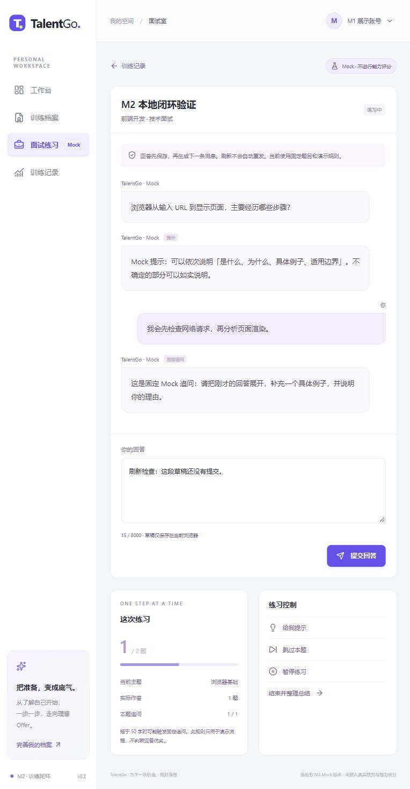
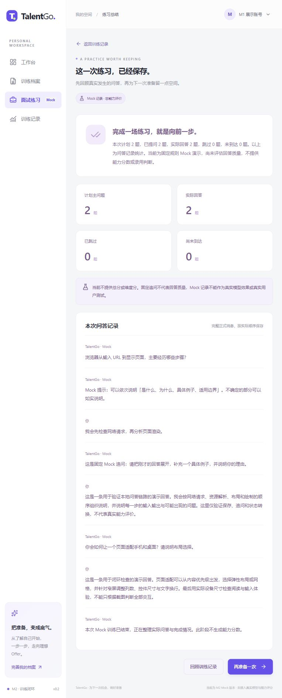

# M2 阶段报告 · Mock 文字面试闭环

日期：2026-11-13，Asia/Shanghai；项目：TalentGo；当前版本：0.2.0。**M2 已完成，完成本地展示与 GitHub 推送后停止，M3 尚未开始。**

## 1. 本轮范围与开发计划

按照用户要求，将项目开发计划展开为完整版本，保留 M0—M6 每一阶段的进入条件、任务分解、数据与接口影响、验证方式、退出标准、角色职责、风险及阶段结束清单。不是用一张表替代实施说明，也没有因更新 M2 状态删去后续细节。详见 [项目开发计划](项目开发计划.md)。

本轮只实现确定性 Mock 闭环，不调用模型服务、不实现四个 Skill、不生成真实能力评价、不写长期记忆。M1 的身份和资料沿用，用户删除的独立记录文档未恢复；本轮实际执行集中记录于本文。

## 2. 已实现的用户流程

1. 在配置页选择岗位、面试类型、题量、难度、追问上限。目标不明确可以留空，进入字段澄清。
2. 使用固定关键词或明确选项补齐缺项，完整配置进入 ready；已知信息不机械重复询问。
3. 点击开始，保存画像快照；首题完整成功提交后进入 interviewing。
4. 提交回答先保存，再创建操作生成后续消息。固定 Mock 依据字符数与追问预算演示追问或换题，不解释成回答质量评价。
5. 支持一次提示、跳过、暂停/恢复、压力模式确认与降低强度、提前结束；非法状态、旧版本、当前题不符或忙碌时拒绝写入。
6. 支持停止和重试。原答案保留，重试沿用原消息，不重复插入用户答案；前端区分生成中、取消、失败与正式消息。
7. 刷新恢复服务端会话和完整问答，本机未提交草稿也保留；网络不确定时保留请求正文与幂等键，显式确认原请求，不自动重发答案。
8. 完成后展示 Mock 总结与实际覆盖，历史列表可继续未完成会话或回顾总结。所有入口按当前身份隔离。

## 3. 后端、数据与运行机制

新增九个会话端点与四个操作端点：会话创建/列表/读取/修改/删除、消息列表/提交、actions、report；操作查询、cancel、retry、events。连同 M1 六个基础端点，当前共 19 个业务方法/路径组合，OpenAPI 以实际注册为准。未来 trace、真实报告导出、成长、记忆、复练、反馈接口未注册。

新增六张表：interview_sessions、questions、messages、operations、operation_events、reports；连同 M1 共九张业务表，另有 alembic_version。head 为 **0002_m2_interview**。当前题与消息使用题目/会话复合外键，消息/事件序号唯一，报告一场一份，活动操作有部分唯一约束。旧 M1 迁移未改写。

同步与异步修改共享身份内幂等回执空间，防止跨接口重复键绕过冲突。事务按用户、会话、操作的稳定顺序加锁；用户级使用 FOR NO KEY UPDATE，与后台外键 KEY SHARE 兼容。长生成不持有事务，每次短写使用独立 SQLAlchemy Session。

执行器为单实例两个工作线程。PostgreSQL advisory lock 阻止同库第二实例执行；启动时将遗留 queued/running 标 PROCESS_INTERRUPTED，允许显式 retry。它不是分布式队列，不恢复供应商内部计算，没有周期租约监控。Mock 单步任务短，heartbeat 只记录进度。

SSE 的事件先持久化再发送，包含 operation_id、seq、attempt_no；GET 只订阅，不生成。前端 fetch 带 Bearer/Last-Event-ID 补发和去重；关闭页面不等于取消操作。七天外终结事件拒绝重放，可读取会话快照；目前未实现定时物理清理。

## 4. 实际检查

| 检查 | 结果与范围 |
|---|---|
| 后端回归 | **35 passed**：原 M1 15 项＋新增 M2 20 项 |
| 完整闭环 | 两主问题完成，报告 ready，实际回答计数正确，total_score=null |
| 澄清与配置 | 缺项补足、压力确认、配置范围、开始后不可改配置、旧 version 拒绝 |
| 对话控制 | 固定追问预算、提示一次、跳过、暂停恢复、提前结束/无答案统计 |
| 幂等/并发 | 创建与答案回放、跨接口键冲突、同会话并发只接收一个生成、终态唯一 |
| 取消/失败重试 | 已保存答案不重复写入，失败首题不提交残片，重试可继续 |
| 恢复 | 持久化未完成操作在实际应用 lifespan 启动路径中变 failed，显式 retry 后可生成 |
| SSE | 事件唯一、Last-Event-ID 补发、非法游标 400、过期 410；读取不启动任务 |
| 权限 | 他人会话、消息、报告、操作及事件均 404，列表只显示本人 |
| 列表与删除 | 分页不重复、错误游标拒绝、取消配置、已完成会话级联删除 |
| 迁移与 ORM | M1→M2→M1→M2 保留测试库基础资料，空测试库升级成功，循环 FK 存在，差异检查通过 |
| 数据库端口 | PostgreSQL 持续使用 6543，开发库没有重置或清空 |
| 前端 | vue-tsc 类型检查和 Vite 生产构建通过，锁文件版本同步为 0.2.0 |
| 浏览器 | 实际两题、提示、固定追问、草稿刷新、下一题、完成总结、历史回顾通过 |

测试只清理 talentgo_test，所有业务测试身份均为程序夹具；本地浏览器使用已有 M1 展示账号，不是课程真实用户测试。进程恢复验证使用持久化 running 夹具并执行应用启动路径，没有宣称完成所有操作系统级强杀/断电演练。

沿用的第三方 TestClient 适配仍有一个 Starlette/httpx 弃用警告，检查通过但未屏蔽。没有真实模型效果、评分准确率、p95 时延、成本或四名用户反馈结论。

## 5. 已发现并修复的问题

- 自动迁移的 use_alter 没有自动创建循环当前题外键：改为所有依赖表创建后显式添加，并验证升降级和空库。
- 配置 PATCH 对嵌套模型使用 exclude_unset 导致默认项丢失：改为保存完整校验后的配置对象。
- 旧 M1 readiness 测试重置旧 head 造成测试结构/版本不一致：更新为当前 head，在核对专用测试库结构后修复标记，并重新执行完整回归。
- 取消与工作线程之间出现 PostgreSQL 40P01 死锁：依据服务器锁日志定位父用户 FOR UPDATE 与外键检查冲突，改用兼容的 FOR NO KEY UPDATE；不是通过吞错或无限重试掩盖。
- 确认取消时读取了 ORM 旧状态：锁定查询显式刷新已有实例；最终状态按数据库事实返回。
- 前端身份/路由切换会有旧请求或流迟到：增加作用域失效、撤销订阅、状态清理和提交结果归属检查。
- 未确认提交在刷新后可能丢请求键：将正文与键保存在本机 sessionStorage，提供原请求确认；草稿单独保存，不将其视为正式答案。

## 6. 本地展示证据

入口：[面试配置](http://127.0.0.1:5173/practice)、[训练记录](http://127.0.0.1:5173/history)、[API 文档](http://127.0.0.1:8000/docs)。重启仍用两个终端分别执行 scripts/start-dev.ps1 与 scripts/start-dev.ps1 -Service frontend，数据库先保持启动。

截图为实际浏览器页面，演示答案明确标为流程验证内容，不冒充真实个人经历。总结记录两题已提问、两题回答、零跳过/未到达，不给能力分。

## 7. 当前限制与下一阶段

Mock 的题目、澄清与追问是确定性演示规则；难度与强度先保存为控制参数，不能将固定问题描述为已经完成真实的个性化能力适配。多实例任务分发、定时事件清理、生产权限/限流/账号恢复、真实评分和长期记忆都未完成。

本轮完整开发计划保留，不缩成摘要。M3 下一步是模型适配、结构校验、四 Skill、题目锚点和证据评分；用户下一次明确继续前，不提前填写这些文件。正常提交并推送 [52611314/TalentGo](https://github.com/52611314/TalentGo) main，不强推；最终同步状态以实际远端 SHA 核对为准。
