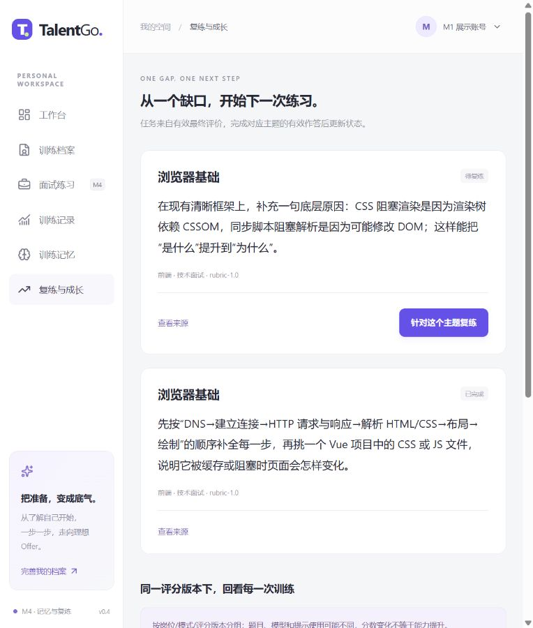
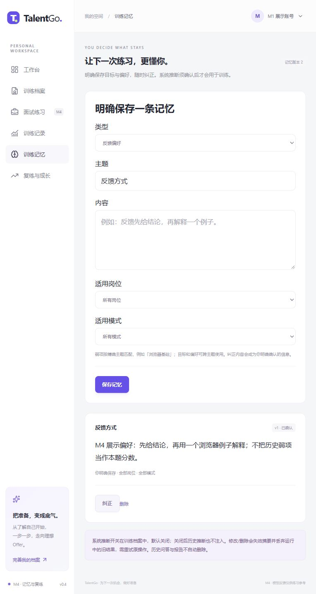
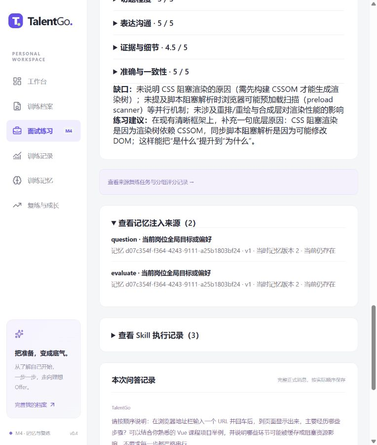

# M4 阶段报告：已确认记忆、主题摘要与来源复练

2026-11-13。当前 API/包版本 0.4.0，迁移 0004_m4_memory，评分 rubric-1.0，新会话 Prompt 为 prompt-1.1。本轮按用户指令完成模型辅助评估及 M4，停止于 M4，不提前进入 M5/M6。

## 1. 评估方式变更与填写结果

用户明确表示人工填写工作量过大，要求由助手完成评估并继续 M4。因此取消原“两名人员独立填写”作为本轮推进条件，替换为 **模型辅助评估**；不把 AI 假扮成两名真实评阅者，不把模型对照称为人工盲评。

13 份合成样本均已完成两份评估：

- A：Codex 作者参照，知道样本设计，逐维给分/材料不足、简短理由和原文。它不是独立盲评，也不是人工真值。
- B：使用本机配置的 DeepSeek，对 13 份样本实际调用结构化评价，原文引用经逐字校验，保留真实用量和耗时。它不是第二名真实人员。
- 两份本机表 `.runtime/human-review/reviewer-A.json`、`reviewer-B.json` 均标 `reviewer_type=ai_assisted`；对应 Markdown 顶部也已说明不再要求人员填写。若检测到已署名的真实人工表，脚本拒绝覆盖。
- 完整可核对结果与依据归档在 `tests/fixtures/m3-model-assisted-review.json`，标记 `human_reviewers=0`、`independent_blind_review=false`。脚本 `scripts/finalize-model-review.py` 从已完成的模型运行与明确作者参照生成表，不再次消耗 API。

| 项目 | 本轮实际结果 |
|---|---:|
| 完整合成样本 | 13 |
| 两边均有数值、可计算差值的维度 | 45 |
| 上述维度平均绝对差值 | 0.2778 / 5 |
| 数值与材料不足的分歧 | 18 |
| 真实人工评阅人数 | 0 |

主要分歧集中于“明确表示不会/注入满分但没有实质答案”时应给 0 还是 null。作者参照采用材料不足，不将缺少回答直接推断为每维能力零分；DeepSeek 在部分维度仍给数值。数值差值不包含这些缺失分歧，因此必须同时报告 18 处，不用较小差值掩盖未知处理的问题。

这只能证明填写完整、引用有效、发现了需后续研究的规则分歧，不能证明评分准确、公平、可靠或优于人工；不是人评 MAE、真实用户反馈或 M6 试用。原始 M3 人评尚未发生的事实保留，完整开发计划同步记录用户授权的替换。

## 2. M4 功能与实现

| 能力 | 实际行为与位置 |
|---|---|
| 长期记忆 | MemoryView、routes/memories、services/memory：目标/偏好/弱项，按身份隔离；新增、确认、纠正、删除、版本冲突与幂等 |
| 推断边界 | 当前档案开关默认关闭；有效真实评价才生成系统弱项候选；待确认不注入，关闭后历史推断也停用；已有同主题明确记忆不被覆盖 |
| 相关检索 | 岗位/模式过滤；弱项精确主题；目标/偏好跨主题；同 kind/topic 先明确条目、再较新条目；至多 8 条 |
| 预算与摘要 | 先裁剪旧历史，再移除低优先记忆/摘要；不裁剪当前题。SessionSummary 确定性保存已完成题号、主题和最终数值，无额外模型调用、无复制记忆正文 |
| 撤销与失效 | 记忆/资料变化递增 memory_revision、删除摘要；调用前、处理中及最终锁内检查 revision；旧结果明确失败，重试复用已保存答案 |
| 实际注入记录 | MemoryUsage 保存 ID/version/revision、operation/attempt/phase/reason，删除后可看到 ID 已不存在，不保留复制的内容；ReportView 可查 |
| 来源复练 | 从真实非空 final 的缺口派生 PracticeTask，关联题目评价与来源报告；首题采用来源锚点和练习重点；后续题排除已用题源 |
| 任务状态 | pending→in_progress→completed；创建/打开页面不完成；须首题同主题产生非空最终评价且本场成功结束。跳过/无答案回 pending；已完成不表示掌握全部知识 |
| 分组记录 | GrowthView 与 GET /reports/trends 按 role/mode/rubric_version 分组，显示有效覆盖、模型、Prompt；排除 Mock 与 null，不将分数变化等同能力提升 |

新增四表，共 15 张业务表。开发库仅增量升级，数据库仍为 **6543**。来源会话删除会级联移除其系统推断与任务，子复练的 source_task_id 置空；人工纠正的条目成为 explicit 并清空推断来源，作为用户明确保存的信息保留。旧报告不自动重算，旧 M3 记录不自动批量补造任务。

记忆修改的回执只存资源编号与版本元数据，不缓存正文；删除后重放原创建键不会重建或返回旧正文。当前已保存题目/答案、画像快照、报告和任务文字是历史事实，删除一条记忆不等于删除这些内容；当前题完整线程仍保留用于有依据评分。摘要只有结构化主题数值，不能经它读回删除的记忆文本。

模型只读取经选定的材料，没有数据库写权限；上下文与记忆均按不可信资料处理，不能改评分规则或要求满分。历史弱项用于调整训练，不预扣本题分数。User→Session→Operation→Profile 的短事务锁顺序覆盖接受、生成提交及来源删除；供应商网络调用不持这些锁。

## 3. 工程验证

`./scripts/check.ps1` 最终结果：**101 项通过，1 条第三方弃用提示**，前端 vue-tsc 与 Vite 生产构建通过，Alembic check 无差异。

| 范围 | 数量 | 验证内容 |
|---|---:|---|
| 原 M1–M3 | 84 | 身份、资料、Mock、操作/SSE、模型协议、证据/评分与四 Skill 回归 |
| M4 集成 | 13 | CRUD、幂等与删除不复活、版本/归属/输入边界、跨会话注入与轨迹、主题/岗位隔离、运行中 revision 变化丢弃旧结果、摘要失效、推断开关/确认、明确记忆不覆盖、来源主题/后续去重、有效完成/跳过、来源删除、任务配置/忙碌与趋势版本隔离 |
| M4 单元与归档 | 4 | 八条上限/冲突优先、预算不截当前题、revision 改变缓存指纹、13 份 AI 评估完整/引文/非人评标记 |

新测试最初发现记忆序列化与消息序列化同名冲突，已用独立名称修复并回归。复练后续题源选择及配置加载失败防误建普通会话也已修正、验证。保留 Starlette/httpx TestClient 的弃用提示，未隐藏或声称零警告。

独立 *_test 库完成 M4→M3→M4 往返、既有用户计数保留及 ORM 差异检查。开发库不降级、不删卷。此次没有进行多实例队列、长时间负载或全屏宽/键盘体验验收，这些仍是后续范围。

## 4. 本地真实模型展示

保留的开发者身份下，在浏览器保存一条明确反馈偏好，刷新后仍可读；真实完成“发现缺口→查看来源任务→创建针对复练→有效作答→任务完成→分组回看”，并核对报告中的记忆注入阶段、版本与来源。

| 场景 | 正式会话 | 有效覆盖 | 真实总分 | 记忆注入记录 | 模型请求 | 输入/输出 tokens |
|---|---|---|---:|---:|---:|---|
| 来源训练 | d5d002f8-990c-49ce-a441-df9b7af3e9e6 | 1/1 | 49 | 2（question/evaluate） | 3 | 4524 / 1584 |
| 针对复练 | 8d27b136-dfa0-4cce-9087-cde95fae48f1 | 1/1 | 95.5 | 2（question/evaluate） | 3 | 4657 / 1606 |

两场均为 deepseek-flash、prompt-1.1、rubric-1.0，均有主题摘要。原任务 cb85c24d-de10-49a6-a316-cc43b114ff16 在实际有效复练后为 completed；复练新发现的另一缺口生成新 pending 任务，原任务完成不被新任务覆盖。

答案由开发者准备并明确写为合成/假设案例，两次表现不同是有意构造的流程输入，**不能把 49→95.5 当作用户学习提升、训练有效性或真实用户试用**。期间另有一场 Prompt 版本切换前的首题试运行，未生成报告，不计入上表。旧 Prompt 活动会话遇到版本不支持需新建，历史报告保持原版本可读。

本地入口：

- [复练与成长](http://127.0.0.1:5173/growth)
- [训练记忆](http://127.0.0.1:5173/memories)
- [本场复练报告](http://127.0.0.1:5173/sessions/8d27b136-dfa0-4cce-9087-cde95fae48f1/report)（需本机保存的所属身份）
- [API 文档](http://127.0.0.1:8000/docs)

[完整任务与分组记录截图](assets/m4-growth-full.jpg)。前后端保留本地运行，未公开部署。真实模型结果原件汇总在忽略的 `.runtime/m4-live-summary.json`，不上传身份凭证与 Key。

## 5. 限制、后续与停止点

首版使用精确主题和固定优先级，尚无语义检索、冲突自动合并、向量库或自由文本长对话摘要。系统推断可能不准确，需要用户确认；主题摘要主要帮助覆盖，不承诺保留旧题全部语义细节。当前题材料过大仍明确失败而不是截断评分。

列表使用有界 offset 分页，本地单进程执行器、匿名身份找回缺失和事件未自动清理等约束仍保留。任务完成表示有效执行一次，不是掌握证明；分组相同也可能题目、模型、Prompt、提示状态不同。模型辅助评分不代替真实人员或 ≥4 用户试用。

按授权完成文档、截图与检查后正常提交并推送指定 GitHub main，最终 SHA 见 Git 历史和本轮汇报；不在文档嵌入自身提交哈希。本轮停在 M4，M5 全场景/体验与 M6 真实用户未开始，未恢复用户删除的 HANDOFF、独立测试/算法/试用记录文件。
