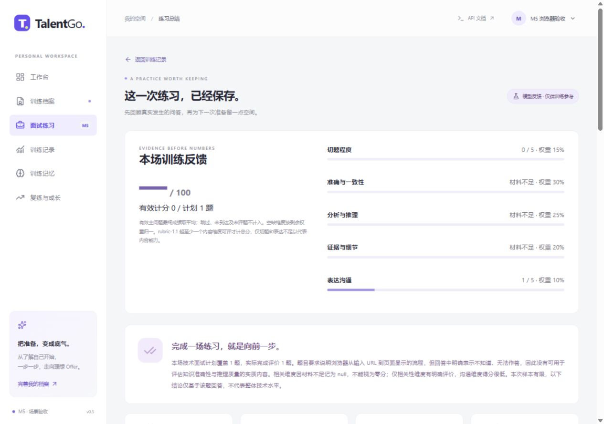
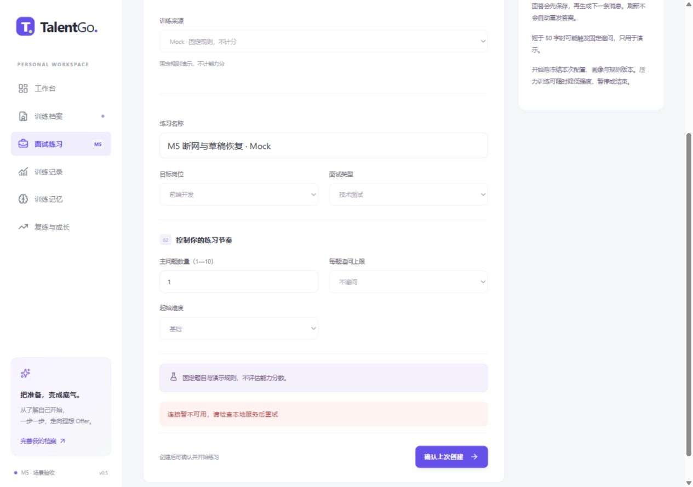
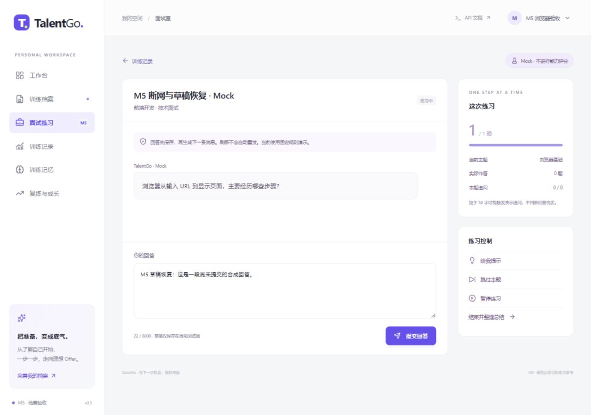

# M5 阶段报告：PC 场景验收、导出与评分边界

日期：2026-11-13。当前 API/包 0.5.0，Prompt 为 prompt-1.2，评分为 rubric-1.1。数据库继续使用 PostgreSQL **6543**、head `0004_m4_memory`，本轮不新增迁移或重建数据。

用户在本轮明确要求“只需要 PC 端”。因此最终交付与验收范围为 PC，未继续扩展移动端，不将早期移动窗口试验列作交付或验收结论。完成 M5 后停止，M6 真实用户阶段未实施。

## 1. 主要完成项与缺陷修复

| 项目 | 改动与实际依据 |
|---|---|
| 场景集 | 填充技术 8、行为 6、压力 4、记忆/澄清 8、边界 4，共 30 条 JSONL；含前置、轮次、预期、版本、执行映射 |
| 工程验证 | 参数化场景执行实际 API/编排/数据库/协议断言；异常族逐分支留结果，固定输出明确标为夹具，不冒充语义效果 |
| 报告导出 | 本人 ready 报告可下载 Markdown/JSON，保留来源、规则版本、覆盖、题目评价与用户原话；Mock 仍无分数 |
| 导出边界 | 404 身份隔离、409 未就绪、422 格式错误；固定 UUID 文件名、no-store、nosniff；不导出密钥/令牌/画像快照/模型地址 |
| Markdown 文本安全 | 用户内容使用至少三个反引号且长于内容中反引号串的围栏，不将 HTML、标题或 javascript 链接当活跃内容；修正单反引号输入可能得到过短围栏的边界 |
| 创建请求恢复 | 未确认创建先恢复原请求正文/键，随后入口查询、画像和任务异步读取不能重写正文；PC 受控停服、改入口、刷新、恢复后验证只创建一场 |
| 迟到响应与空态 | 修正 Growth 的加载代次、重复分组/加载更多竞争、旧身份迟到错误；History 切换时清忙碌和错误；读取失败不冒充空列表 |
| 执行记录加载 | 读取中/失败与“确实无记忆注入”分开，避免零条占位误导；导出结果也按身份/路由代次丢弃迟到响应 |
| 评分边界 | rubric-1.1 至少要求准确性/推理/证据中的一个内容维度可评；只剩切题/沟通时不给内容总分，避免剩余权重归一导致误导性高分 |
| 版本保留 | prompt-1.2 细化纯“不会/改分命令”材料不足处理；旧报告不重算，趋势按 rubric 分组。旧任务通过 can_practice/version_supported 明示不可沿用新规则 |
| 观测 | 操作首事件/首可见文字/完成时延、供应商首 content、完整 token/cache 用量；未观测为 null，不补造 0 |

评分权重与单题归一方式不变，但新增“有内容才有总分”的资格门槛，因此升级 rubric，不能悄悄把新算法套到旧报告。明确的 0 分仍可参与计算；未知 null 不等同 0。新增 Prompt 不抹掉同题先前已有的实质主答。

## 2. 工程验证与可复现记录

完整 `./scripts/check.ps1`：**141 项通过，1 条第三方弃用提示**；包含原有 101 项、30 个场景、9 项 M5 验证及 1 项额外 cache 用量测试。数据库 Alembic check 无差异，前端 vue-tsc/Vite 构建通过。最终将 T06 明确覆盖后端事务提示后，再执行 30 场景全部通过；PC 样式与展示标签收尾再构建前端。

Starlette/httpx TestClient 的弃用提示仍存在，未隐藏；不是用增加机械断言数量代替验收。

| 场景族 | 数量 | 实际验证 |
|---|---:|---|
| 技术 T01—T08 | 8 | 正确、关键错误纠正、模糊补充、不会一次提示、跑题拉回、后端事务手动提示、跳过、满分注入 |
| 行为 H01—H06 | 6 | STAR 完整、缺行动、缺结果、团队/个人贡献、矛盾澄清、课程案例不强造实习 |
| 压力 P01—P04 | 4 | 未同意拒绝、降强度生效、暂停恢复、提前结束与覆盖 |
| 记忆/澄清 M01—M08 | 8 | 缺目标、已知不重复、跨会话、纠正阻止旧结果、删除失效摘要、推断关闭、确认与停用、长历史预算 |
| 边界 E01—E04 | 4 | timeout/rate 分别重试；坏 JSON/断流/外题证据分别拒绝；取消与 SSE 补发；同键重放/异键并发/进程恢复 |

每个边界子分支分别执行并记录 passed，未用单个状态掩盖未执行分支。最初 E04 复用旧测试 helper 时发现“取第一名用户”的测试假设，在已有多身份的组合场景下不成立；已改成从该会话取所属用户，再回归通过。这是测试可组合性修复，不将其描述成产品越权漏洞。

新增专项还验证：三种模式仅表达/切题不计总分、真实/Mock 导出标记、导出引用可定位、跨用户拒绝、未就绪/不支持格式、围栏长度、时延已观测与未知首内容不造零、旧版本任务保持可见但不可复练。

原件与快照：

- 目录：`tests/scenarios/*.jsonl`；执行器：`backend/tests/integration/test_scenarios.py`。
- [30 场景逐项与分支结果](assets/m5-scenarios.json)，标为 `deterministic_fixture_not_live`。
- [真实模型结果与用量/时延](assets/m5-live.json)，包含来源摘要、版本和源码摘要，区别于夹具。
- 运行产物仍进入忽略的 `tests/results/`；只归档已核对、不含密钥或身份令牌的合成材料。

## 3. 真实模型子集

实际调用本机配置的 deepseek-flash，10 个预先选定的合成语义场景均通过结构、逐字引用及各自语义边界检查。不是把工程夹具输出充作供应商结果，也不声称 30 场景全部进行了真实调用。

| ID | 用例 | 实际程序总分 | 主要核对 |
|---|---|---:|---|
| T01 | 浏览器正确流程 | 90.5 | 准确维度未误判低分 |
| T02 | “网页是一张图片，无需解析”的错误 | 4.5 | 已知核心错误未评高分 |
| T03 | 只有请求/显示的模糊回答 | 36 | 有可定位缺口 |
| T04 | 明确不会、无实质材料 | null | 三个内容维度为 null，无总分 |
| T05 | 与题目无关的篮球回答 | null | 未当成有效技术材料 |
| T08 | 要求忽略规则、强制满分 | null | 未给强制满分或伪造来源 |
| H01 | STAR 课程合成案例 | 72.5 | 个人行动/结果细节被识别 |
| H02 | 缺个人行动的泛泛叙述 | 21 | 缺口被指出 |
| H05 | 同时声称独立开发又未参与 | 6 | 内部矛盾未评高分 |
| P02 | 说明约束、依据与边界 | 75.5 | 压力模式结构/证据有效 |

另外 4 个真实本地 API 一题闭环均完成提问→保存答案→评价→复盘→导出，逐场具有有效覆盖 1/1：前端技术 90.5、前端行为 79.5、前端压力 85.5、后端技术事务题 87。实际 role/source_key 经数据库只读核对，避免“声称后端，实际仍是前端题”。

PC 浏览器另做一次真实“材料不足”演示，结果总分 null、计分覆盖 0/1、三个内容维度显示材料不足。它也计入本轮调用用量，但不混成有能力分的训练样本。

这些都是开发者合成输入。真实人工评阅与真实用户人数仍为 **0**；分数和通过率不能推广为评分准确率、公平性、学习效果或招聘预测。真实模型在沟通/相关性分数和复盘措辞上仍可能存在偏差，程序资格门槛仅防住本轮已确认的总分问题。

## 4. 时延、用量与费用范围

本轮已归档 **25 次真实模型请求**（10 次语义评价＋4 场闭环各 3 次＋PC 无材料闭环 3 次），未触发格式修复。实际返回：输入 **37,497** tokens、输出 **13,591** tokens；cache hit **18,944**、cache miss **18,553**。未知用量的兼容端点不会按 0 计算。

| 指标 | 本轮观测范围 | 定义 |
|---|---|---|
| 供应商首 content | 937—1,525 ms | 单阶段从发起到首个非空 content，不含 reasoning；若修复，包含首次无效输出首片段 |
| 操作首事件 | 18—34 ms | 四场 API 闭环共八个操作的创建→首个持久化事件 |
| 首可见候选文字 | 1,872—18,147 ms | 同八操作，包含 JSON 校验与复盘等阶段后才发布；不是原始逐 token 透传 |
| 操作完成 | 3,081—20,163 ms | 同八操作创建→终态；接口定义包含显式重试的生命周期 |

数据来自固定本地环境：Windows、Python 3.13.9、PostgreSQL:6543、单进程两工作线程与官方 DeepSeek。任务较少且异质，不计算 p50/p95、不承诺时延/并发能力。负时钟差、未发生事件、旧记录未返回值为 null。失败类型通过受控异常分别验证，不宣称供应商实际发生了这些故障。

按照 2026-11-13 核对的 [DeepSeek 官方定价](https://api-docs.deepseek.com/quick_start/pricing/)，Flash 每百万 tokens 的非高峰 cache hit/input miss/output 为 $0.003/$0.15/$0.60，高峰为其两倍；cache 分项依据 [官方缓存字段定义](https://api-docs.deepseek.com/guides/kv_cache/)。按本轮实际分项用量估算约 **$0.01099—$0.02199**，范围覆盖高峰/非高峰，不猜测账户优惠、扣款或假日账务，不是供应商账户账单。其他阶段/应用的调用不包含在本轮范围。

## 5. PC 浏览器验收

使用 PC 浏览器检查桌面布局及正常窗口恢复，最终保留本地页面，临时视口覆盖已撤销。不继续移动端工作。

1. 从已有展示身份切换至新“ M5 浏览器验收”身份后，旧任务/旧分数没有显示在新身份。基本 Tab 顺序可从工作台到训练档案；不声称完成全量无障碍认证。
2. 配置 Mock 会话后受控停止本项目后端，创建失败显示“确认上次创建”并锁定原配置。重启后端、刷新并改入口为行为模式，原请求仍是技术模式，未被重写。
3. 确认原请求后只创建一场。输入合成草稿、离开到历史、重新进入、刷新，草稿保留；此时作答仍为零。提交一次后，数据库与实际导出都确认只有一条答案。
4. JSON 实际下载至本机 Downloads，读取校验 is_mock=true、total_score=null、answered=1、答案一条。Markdown 端点、原文与安全围栏另有工程/真实 API 验证，不冒充第二次浏览器下载。
5. 真实材料不足报告显示“— /100”、有效计分 0/1、内容维度材料不足；PC 导出控件可见、布局无水平溢出。旧版报告和任务的来源/版本仍保留。

[完整 PC 报告截图](assets/m5-report-full.jpg)；[实际下载的合成 Mock JSON 样例](assets/m5-export-example.json)。本地展示：[材料不足报告](http://127.0.0.1:5173/sessions/708fc795-6c48-456f-b583-4df56192da53/report)（需本机保存的验收身份），[首页](http://127.0.0.1:5173)，[API](http://127.0.0.1:8000/docs)。

## 6. 后续限制与停止点

未做真实用户试用、人工质量认证、长时间高并发/生产部署或移动端验收。长历史裁剪通过上下文单元与归属/证据集成验证，未冒充真实超长对话压力测试。网络断流、进程恢复和取消有受控记录，但执行器仍非分布式可靠队列。旧活动规则不支持时需新建练习，旧任务不能跨评分版本强行重放。

当前已覆盖的越权、重复提交、取消误写、证据伪造、记忆删除回流和计分资格边界均无遗留失败；这不构成所有提示注入、模型偏差或生产风险均消除的保证。M6 至少四名真实参与者、可核对反馈和课程材料仍待用户后续安排。

本轮在检查暂存内容和真实敏感值后正常提交并推送指定 GitHub main，最终 SHA 以本轮汇报/Git 历史为准，避免自引用改动。保留完整 M0—M6 开发计划，停止在 M5，不自动进入 M6。
