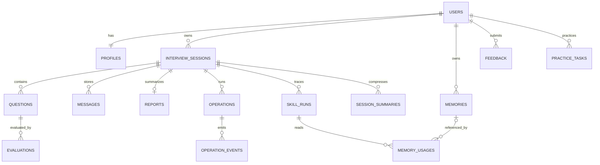

# 数据库设计

## M2 实际迁移与存储增补

2026-11-13：当前 head 为 0002_m2_interview，在 M1 三表上新增 interview_sessions、questions、messages、operations、operation_events、reports，共九张业务表，另有 alembic_version。M1 迁移未改写；增量往返和空测试库重建已验证，开发档案保留。

M2 字段以该迁移和 ORM 为准，是下文完整目标设计的子集：questions 保存主题/序号/固定文本/难度/状态/追问数，暂不含 rubric；没有 evaluations、memories 或 practice_tasks。reports 只有状态、Mock 标识、覆盖、摘要与可空总分，没有真实评分。operations 保存 key_hash、request_payload、expected_session_version、attempt_no、status、cancel_requested、result_refs、error_code、heartbeat_at、finished_at；请求数据含已校验答案及消息引用，不写入运行日志。

共享 idempotency_receipts 同时覆盖 M1 资料与 M2 修改，不把同步和异步操作分成可绕过的键空间。用户级 FOR NO KEY UPDATE 串行化请求回执，与工作线程外键 KEY SHARE 兼容；会话/操作加锁顺序一致。活动操作使用部分唯一索引；消息和事件序号有唯一约束；当前题与消息题号使用复合外键校验所属会话。循环当前题约束在建表后显式增加，延迟到事务末检查。

单实例通过 PostgreSQL advisory lock 拒绝同库第二执行器。heartbeat 是进度记录，不是已实现的租约/分布式队列；启动扫描只在持有实例锁后执行。事件超过七天拒绝重放，但尚无定时清理；已有正式消息和报告继续可读。删除会话先清当前题引用，再由 FK 级联删除 M2 数据，删除操作回执独立保留用于幂等重放。

版本：设计契约 v0.1；日期：2026-11-13。**M1 首次建立 users、profiles、idempotency_receipts；M2 已增量建立六表，详见上方。以下字段说明包含尚未实现的完整目标设计，不能仅凭表名判断字段已实现。**

M1 同步修改使用独立 idempotency_receipts：id、created_at、user_id（FK users）、key_hash、request_hash、response_data（JSONB），UNIQUE(user_id,key_hash)。只缓存资料响应，不含身份 token。M2 引入长操作时需共享请求键冲突语义，不能让两个存储绕过幂等。

## 1. 实例与连接

| 项目 | 约定 |
|---|---|
| 引擎 | PostgreSQL 17 系列，正式依赖版本后续锁定 |
| 本机开发地址 | localhost:6543 |
| Compose 内地址 | db:6543，容器 PostgreSQL 显式监听 6543 |
| 开发库 | talentgo |
| 集成测试库 | talentgo_test，独立数据与凭据 |
| 应用角色 | talentgo_app；密码由本地环境提供 |
| 编码/时区 | UTF-8；存储 UTC，界面转换为 Asia/Shanghai |
| 驱动 | psycopg 3；SQLAlchemy URL 前缀 postgresql+psycopg |
| 迁移 | database/migrations，配置入口 backend/alembic.ini |

连接格式仅作说明：`postgresql+psycopg://talentgo_app:<URL编码后的密码>@localhost:6543/talentgo`。不得把真实密码写入文档或提交版本库。迁移账户与应用账户后续按权限分离；应用账户不应拥有超级用户权限。

## 2. 类型与命名

- 表名 snake_case 复数；主键 id 为应用生成 UUID；API 中序列化为字符串。
- 时间统一 TIMESTAMPTZ；创建时刻 created_at 必填，更新实体另有 updated_at。
- 可扩展结构使用 JSONB；核心关系使用外键，不靠 JSONB 中的字符串维持完整性。
- 分数用 NUMERIC：维度 NUMERIC(3,2)，范围 0—5；总分 NUMERIC(5,2)，范围 0—100。未评价使用 NULL，不用 0 表示失败。
- 枚举首版用 VARCHAR＋CHECK，降低扩展和迁移复杂度；字段长度和输入长度同时受 API 约束。
- 以下字段末尾 `?` 表示可空；未标注则非空。通用 id、created_at 在各表默认存在。

## 3. 实体关系

## 4. 字段设计

### users：匿名训练身份

| 字段 | 类型 | 说明 |
|---|---|---|
| display_name | VARCHAR(60) | 昵称，不要求真实姓名 |
| token_hash | VARCHAR(128) UNIQUE | 高熵令牌哈希，不保存原始 token |
| creation_key_hash | VARCHAR(128) UNIQUE | 匿名身份创建请求键哈希；重放只报冲突，不再次返回 token |
| status | VARCHAR(16) | active/revoked |
| updated_at | TIMESTAMPTZ | 身份更新时间 |

profile 在身份创建事务中同步建立。每次请求由身份依赖解析 user_id，客户端不能指定其他用户身份。

### profiles：可修改的当前画像

| 字段 | 类型 | 说明 |
|---|---|---|
| user_id | UUID UNIQUE FK users | 一对一 |
| target_role? | VARCHAR(32) | frontend/backend，未选择可空 |
| experience_level? | VARCHAR(24) | beginner/intern/graduate |
| tech_stack | JSONB | 字符串数组 |
| background | TEXT | 用户主动输入的背景，默认空串 |
| goals | TEXT | 用户训练目标，默认空串 |
| feedback_style | VARCHAR(24) | concise/detailed/guided |
| allow_inferred_memory | BOOLEAN | 默认 false，用户可选择启用归纳记忆 |
| version | INTEGER | 乐观锁，自 1 递增 |
| memory_revision | INTEGER | 自 1 开始，记忆新增/更新/删除时递增，用于摘要和运行结果失效 |
| updated_at | TIMESTAMPTZ | 更新时间 |

### interview_sessions：会话与固定快照

| 字段 | 类型 | 说明 |
|---|---|---|
| user_id | UUID FK users | 所有者 |
| title | VARCHAR(120) | 用户标题或系统生成标题 |
| role? / mode? | VARCHAR(32) / VARCHAR(24) | 澄清阶段可空；ready 前必填；mode 为 technical/behavioral/pressure |
| status | VARCHAR(24) | clarifying/ready/interviewing/paused/evaluating/completed/aborted |
| config | JSONB | question_count 1—10、difficulty 1—3、max_followups 0—2、pressure_level 1—3、压力模式的 pressure_consent 等 |
| profile_snapshot | JSONB | 开始面试时冻结画像；不含 token |
| rubric_version? / prompt_version? | VARCHAR(64) | 开始前可空，开始后冻结 |
| provider | VARCHAR(24) | mock/deepseek |
| model_name? | VARCHAR(120) | 真实模型名，Mock 可空 |
| source_task_id? | UUID FK practice_tasks | 复练入口来源 |
| version | INTEGER | 每次有效状态/消息变更递增 |
| current_question_id? | UUID FK questions | 当前主问题，提交时验证所属会话 |
| started_at? / ended_at? | TIMESTAMPTZ | 未开始/结束时可空 |
| updated_at | TIMESTAMPTZ | 最近变更时间 |

question_count 为主问题数量，追问不占主问题配额。结束不补造未作答分数。

### questions：主问题及追问预算

| 字段 | 类型 | 说明 |
|---|---|---|
| session_id | UUID FK interview_sessions | 所属会话 |
| ordinal | INTEGER | 主问题序号，从 1 开始 |
| topic / skill_key | VARCHAR(80) / VARCHAR(40) | 知识点与 Skill |
| content | TEXT | 完整主问题，生成提交后不可被后续增量改写 |
| difficulty | SMALLINT | 1—3 |
| rubric_snapshot | JSONB | 本题锚点、维度与版本 |
| source_key? | VARCHAR(120) | 题库来源，模型临时生成可空 |
| status | VARCHAR(24) | open/answered/skipped/unscored |
| followup_count | SMALLINT | 已提交追问次数，不超过 config.max_followups |

UNIQUE(session_id, ordinal)。追问是 messages 中关联本题的 assistant 消息，不创建新主问题行。

### messages：完整正式消息

字段：session_id UUID FK；question_id? UUID FK；operation_id? UUID FK；seq INTEGER；speaker VARCHAR(16)（user/assistant/system）；kind VARCHAR(24)（clarification/question/answer/followup/hint/notice）；content TEXT；metadata JSONB（提示使用、附件禁用说明等非秘密元数据）。UNIQUE(session_id, seq)。

不保存 token 级增量到本表。只有完整、成功提交的问题才成为可回答消息。消息一经提交不修改；错误通过新 notice 或评价版本表达。

### evaluations：单题评价的版本与证据

字段：session_id UUID FK；question_id UUID FK；operation_id UUID FK；revision INTEGER；scope VARCHAR(16)（provisional/final）；status VARCHAR(16)（valid/invalid）；dimensions JSONB；evidence JSONB；missing_points JSONB；suggestion TEXT；question_score? NUMERIC(5,2)；rubric_version VARCHAR(64)；prompt_version VARCHAR(64)；provider VARCHAR(24)；model_name? VARCHAR(120)；is_mock BOOLEAN。

dimensions 的五个 key 固定为 relevance、accuracy_consistency、reasoning、evidence_detail、communication；每项包含 score（0—5 或 NULL）和 reason。evidence 项包含 message_id、quote、dimension；写入前验证 message 为本题用户答案且 quote 确为原文。UNIQUE(question_id, revision)。每题最多一条有效 final，使用条件唯一索引约束。invalid 行不进入成绩。

### reports：整场最终复盘

字段：session_id UUID UNIQUE FK；status VARCHAR(16)（pending/generating/ready/failed）；dimension_scores JSONB；weights JSONB；total_score? NUMERIC(5,2)；coverage JSONB（planned/answered/scored/skipped/unscored）；strengths JSONB；gaps JSONB；recommendations JSONB；rubric_version VARCHAR(64)；prompt_version VARCHAR(64)；provider VARCHAR(24)；is_mock BOOLEAN；updated_at TIMESTAMPTZ。

每场保留一份最终报告。重试失败生成复用该行，ready 后不可覆盖；修改评分算法需未来显式版本化重算方案。无有效答案时 total_score 为 NULL，并说明材料不足。

### memories：长期事实、偏好和归纳

字段：user_id UUID FK；kind VARCHAR(24)（goal/preference/weakness）；topic VARCHAR(80)；content TEXT；source_type VARCHAR(24)（user_explicit/system_inferred）；source_session_id? UUID FK；source_message_id? UUID FK；source_evaluation_id? UUID FK；confirmed BOOLEAN；version INTEGER；updated_at TIMESTAMPTZ。

弱项归纳优先关联评价；用户手工记忆可无会话来源。服务检查来源记录与 user_id 一致。用户编辑即 version＋1，用户确认作为明确事实；自动推断不能覆盖已确认冲突条目。删除采用硬删除，未来请求不再读取该项。

### memory_usages：实际读取轨迹

字段：skill_run_id UUID FK；memory_id? UUID FK memories ON DELETE SET NULL；memory_version INTEGER；reason VARCHAR(240)；purpose VARCHAR(24)（questioning/evaluation/review）；seq INTEGER。记录被注入的 ID/版本，不复制记忆正文。删除记忆后保留“来源已删除”的读取事件，不允许重新注入旧正文。UNIQUE(skill_run_id, seq)。

### session_summaries：历史压缩

字段：session_id UUID FK；through_message_seq INTEGER；content TEXT；profile_version INTEGER；memory_revision INTEGER；prompt_version VARCHAR(64)；invalidated_at? TIMESTAMPTZ。UNIQUE(session_id, through_message_seq, memory_revision)。摘要只压缩用户对话，不复制注入的长期记忆。记忆或画像变更时相关摘要失效并在下次重建，避免旧偏好经摘要回流。

### skill_runs：能力执行元数据

字段：session_id UUID FK；operation_id UUID FK；skill_key VARCHAR(40)（clarify/technical/behavioral/pressure/review/summary）；skill_version VARCHAR(64)；status VARCHAR(16)（running/succeeded/failed/cancelled）；input_refs JSONB；output_refs JSONB；provider VARCHAR(24)；model_name? VARCHAR(120)；latency_ms? INTEGER；input_tokens? INTEGER；output_tokens? INTEGER；error_code? VARCHAR(80)；finished_at? TIMESTAMPTZ。

仅记录引用、版本和用量，不保存完整系统 Prompt 或内部思维链。供应商未返回 token 用量时使用 NULL，不伪造 0。

### operations：可追踪的长操作

字段：user_id UUID FK；session_id? UUID FK；kind VARCHAR(32)（clarify/start/answer/hint/skip/finish/report_retry/resource_mutation）；idempotency_key VARCHAR(80)；request_hash VARCHAR(128)；request_payload JSONB（不含秘密，仅保存重试所需输入引用）；expected_session_version? INTEGER；attempt_no INTEGER；status VARCHAR(16)（queued/running/succeeded/failed/cancelled）；cancel_requested BOOLEAN；result_refs JSONB；error_code? VARCHAR(80)；heartbeat_at? TIMESTAMPTZ；lease_expires_at? TIMESTAMPTZ；finished_at? TIMESTAMPTZ；updated_at TIMESTAMPTZ。

UNIQUE(user_id, idempotency_key)；相同键不同内容返回 409。同一 session_id 的 queued/running 使用部分唯一索引限制为一条。失败重试增加 attempt_no，不能重复插入用户消息。同一用户上下文中所有修改接口均要求幂等键，非长操作用 resource_mutation 保存 succeeded 回执，request_payload 另记录规范化 method/path。身份首次签发例外由 users.creation_key_hash 约束，不在操作回执中缓存 token。

### operation_events：SSE 补发

字段：operation_id UUID FK；seq INTEGER；attempt_no INTEGER；event_type VARCHAR(32)（operation.started/text.delta/state.changed/operation.succeeded/operation.failed/operation.cancelled）；payload JSONB。UNIQUE(operation_id, seq)。seq 跨重试递增，不从零重新计数。仅第一、二类允许临时显示，正式数据以成功提交结果为准。终结操作的事件设计保留 7 天，过期订阅返回 410，客户端读取状态快照。

### practice_tasks：复练任务

字段：user_id UUID FK；source_session_id? UUID FK；source_evaluation_id? UUID FK；topic VARCHAR(80)；role VARCHAR(32)；mode VARCHAR(24)；goal TEXT；status VARCHAR(24)（pending/in_progress/completed）；completed_session_id? UUID FK；updated_at TIMESTAMPTZ。完成以复练会话有相应有效最终评价为依据，不能仅因点开页面就完成。

### feedback：用户反馈

字段：user_id UUID FK；session_id? UUID FK；ratings JSONB（relevance/coherence/actionability/usability/reuse，每项整数 1—5）；comment TEXT；consent_to_course_analysis BOOLEAN；allow_quote BOOLEAN；schema_version VARCHAR(32)。反馈是实际用户操作产生的记录；不得预置伪造用户评价。展示聚合时不暴露用户身份令牌。

## 5. 索引与完整性

必要索引：sessions(user_id, created_at DESC)、sessions(user_id,status)、messages(session_id,seq)、questions(session_id,ordinal)、evaluations(question_id,revision)、memories(user_id,kind,topic,updated_at)、operations(user_id,idempotency_key)、operation_events(operation_id,seq)、skill_runs(session_id,created_at)、practice_tasks(user_id,status)、feedback(user_id,created_at)。已有 UNIQUE 覆盖时不重复建同列索引。

单列 FK 不自动保证两个资源同属会话/用户。对 questions/messages/evaluations 的 (id, session_id) 增加唯一约束并使用组合外键；对于来源记忆、task 和 report 的跨用户引用，在服务层校验且纳入越权集成测试。后续必要时增加复合约束，不只依赖前端隐藏入口。

检查约束包括：difficulty/pressure_level 1—3、question_count 1—10、followup_count 0—2、version/revision/seq 为正数、评分范围、状态枚举。JSONB 内字段由 Pydantic 和服务校验，不能仅假设 JSONB 自带结构约束。

## 6. 事务和删除

- 保存用户消息与创建操作为短事务；模型调用在事务外；结果提交时锁定会话、核对 version 和操作终态。
- 评价与问题切换原子提交；最终报告与会话 completed 原子提交；总分仅接受后端规则计算。
- 完整删除会话需要先处理 current_question_id 等循环引用，再级联删除消息、题目、评价、报告、摘要、运行、操作和事件。此删除流程必须有集成测试。
- 由会话产生的记忆、任务随来源会话一并删除；其他会话的 source_task_id 和 completed_session_id 置空，不删除其训练内容。手工记忆保留。
- 正在运行的会话删除返回 409，先取消并确认操作终结。删除身份需显式确认并删除其全部数据，首版 API 暂不暴露该能力。
- 记忆删除不重写旧正式回答和历史报告，但摘要失效；新请求不使用已删除条目，运行轨迹不保留正文副本。已生成历史内容可能反映旧偏好，界面说明这一范围。

## 7. 迁移与备份

M1 已编写首次迁移，仅创建基础三表；会话/题目、复练任务及循环 FK 在后续迁移分阶段添加。种子脚本仅用于开发假数据和公开题库，不承担建表。

迁移先在空 talentgo_test 上升级，再核对约束、回滚和重新升级。正式训练库迁移前备份。备份计划用 pg_dump 自定义格式，通过环境或密码文件提供凭据，连接端口 6543；文件放 database/backups 或用户另行指定的位置，不提交 Git。恢复验证必须使用独立数据库，不覆盖现有资料。

后续 .gitignore 必须排除 .env、.venv、node_modules、数据库备份、测试产物、用户资料和令牌。M1 .gitignore 已排除上述私密数据和运行产物，实际 .env 不提交。
