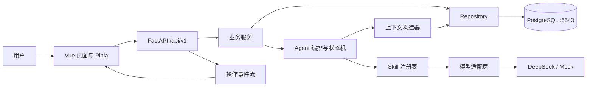

# 架构设计

状态：2026-11-13，M1 基础分层已实现。已开放身份、资料与健康；下文 Agent、面试状态机、操作/SSE 和记忆均为后续设计。主库 PostgreSQL:6543。

## 1. 总体结构

前端负责输入、可视化和流消费；后端是状态、评分、权限和数据的唯一事实来源。Skill 不直接操作 HTTP 或数据库，由服务层提供受控数据与写入路径。

## 2. 后端职责

| 位置 | 责任 | 禁止混入 |
|---|---|---|
| app/api/v1/routes | 鉴权依赖、请求与响应、状态码 | 模型 Prompt、复杂评分规则 |
| app/schemas | Pydantic 输入输出契约 | ORM 查询、外部调用 |
| app/services | 用例、事务边界、权限、操作协调 | 页面状态 |
| app/repositories | ORM 查询与持久化 | LLM 调用、业务流程选择 |
| app/models、app/db | ORM、连接、工作单元基础 | API 序列化规则 |
| app/agent | 状态机、上下文、Skill 路由和调用契约 | 硬编码身份或密钥 |
| app/llm | 真实/Mock 统一接口、超时、输出校验支持 | 最终总分和用户权限 |
| app/knowledge | 题库、评分标准、知识锚点 | 用户对话、密钥 |
| app/core | 环境配置、错误、日志、身份令牌处理 | 场景专属规则 |

## 3. 前端职责

- views：训练首页、配置、面试、报告、历史、资料与记忆、反馈。
- api：统一 HTTP、身份头、错误映射与流连接；不在 Vue 组件里拼接散乱 URL。
- stores：身份令牌、资料快照、当前会话索引；刷新后向后端重新读取实际状态。
- composables：操作流与会话恢复；组件卸载断开订阅，但不自动删除服务端数据。
- types：接口、会话、评价、记忆契约；不由前端自行推断总分。
- components/debug：仅展示用户自身的运行元数据，隐藏密钥、完整上下文和思维链。

## 4. 面试状态机

| 当前状态 | 允许行为 | 目标状态 |
|---|---|---|
| clarifying | 补充配置、回答澄清、取消 | ready / clarifying / aborted |
| ready | 修改配置、开始、取消 | interviewing / clarifying / aborted |
| interviewing | 回答、提示、跳过、停止生成、暂停、结束 | interviewing / paused / evaluating |
| paused | 恢复、结束 | interviewing / evaluating |
| evaluating | 查询、重试失败的报告任务 | completed，失败时保持 evaluating |
| completed | 查报告、导出、创建复练、删除 | 不再改变本次答题内容 |
| aborted | 查询取消状态、删除 | 不生成正式成绩 |

创建时缺岗位或 mode 则 clarifying，否则 ready。开始后不改 mode/role/画像快照/评分标准，需另建会话。暂停不改变已保存答案；压力强度可在面试中降低，并记录变更。结束含提前结束：没有作答的问题不计零分，报告标注覆盖不足。`completed` 仅在报告和最终分已成功保存后设置。

每个会话另有 version 乐观锁。长操作状态独立存 operations（queued/running/succeeded/failed/cancelled），避免将“正在生成”混成会话业务状态。同一会话最多一个 queued/running 操作。

## 5. 一轮回答的执行顺序

1. 验证身份、会话归属、状态、version、当前 question_id 与幂等键。
2. 短事务保存完整用户消息、创建操作、更新会话 version，随后提交。不在模型请求期间持有行锁。
3. 编排器读取快照、相关记忆、摘要和最近消息，记录实际注入的记忆版本。
4. 调用评价，再按规则决定追问或换题。评价不合格时不产生正式分；格式修复最多一次。
5. 每次写入前检查操作取消标记和会话版本；原子保存评价、完整问题、消息和 Skill 运行记录。文本增量仅供显示，不代表结果已提交。
6. 写入终结事件，释放会话操作占用。客户端根据成功事件重新读会话。

失败时保留用户输入，操作变为 failed；用户重试原操作，不新增同一条答案。终结前的临时文本不进入正式消息。先生成后提交，避免半条问题进入答题状态。

## 6. 生成任务与 SSE

首版单实例后端，短期任务由应用内受控执行器运行，操作与事件存 PostgreSQL；它不是持久化消息队列。GET 事件流只订阅、不启动生成。

- 每个操作记录心跳与失效时间；进程重启后将过期 running/queued 操作置 failed（PROCESS_INTERRUPTED），提供人工重试，不静默声称已恢复计算。
- SSE 按 operation_id 与单调 seq 排序，事件先持久化再发送；重连按 Last-Event-ID 补发。
- 浏览器断流不等于取消；停止按钮显式请求取消操作。完成与取消竞争时按数据库终态裁决，终态只允许一次。
- 不承诺重放模型内部生成状态。失败后重新调用模型可能产生不同文本，保留 attempt_no 与模型版本。
- 多进程和多实例扩展需要引入任务租约/队列与跨实例通知，列为后续设计，不在首版假设可靠。

## 7. 记忆与上下文

注入顺序：系统规则 → Skill 规则与评分锚点 → 画像快照 → 相关长期记忆 → 历史摘要 → 最近完整消息 → 当前输入。上下文预算超限时先去除低相关记忆、缩短旧历史，再生成摘要；保留当前题完整对话。仍超限则要求缩短输入，不静默丢弃当前答案。

长期记忆先按当前 user_id 隔离，再按岗位/主题/类型筛选，并优先用户明确确认和较新条目。记录 memory_id/version、原因、用途，不存“思维过程”。用户禁止推断记忆时不写入自动归纳；删除或纠正后，新请求不得继续使用旧条目，旧运行只保留不可反注入的审计引用。

## 8. 身份与数据边界

首版匿名训练身份：后端生成高熵 Bearer token，仅保存 token 哈希，客户端保存原始令牌。它只是课程本地应用的身份隔离设计，不等于已实现完整账号系统。令牌遗失后的恢复、邮件注册与第三方登录不在首版范围。

所有会话、记忆、报告与操作均由服务端身份解析 user_id，忽略/拒绝客户端冒充 user_id。跨用户资源按 404 处理。API Key 不进入前端；CORS 限定开发源。公开部署前需补齐 HTTPS、身份恢复与限流方案。

## 9. 运维与数据库

服务端和客户端数据库端口都用 6543；Docker 方案为宿主 127.0.0.1:6543 → 容器 6543，容器 PostgreSQL 显式以 `-p 6543` 启动，健康检查同端口。应用容器连接主机名 db，本机后端用 localhost。仅改映射而不改服务端监听不符合本项目约定。

数据库迁移唯一入口为 database/migrations，由 backend/alembic.ini 定位。生产式资料不得写入种子数据。日志只记录 ID、状态、耗时、token 用量等元数据，默认不记录完整回答。备份及清理策略见数据库设计；M1 已启动本机数据库与前后端，未公开部署，未进行备份恢复演练。
