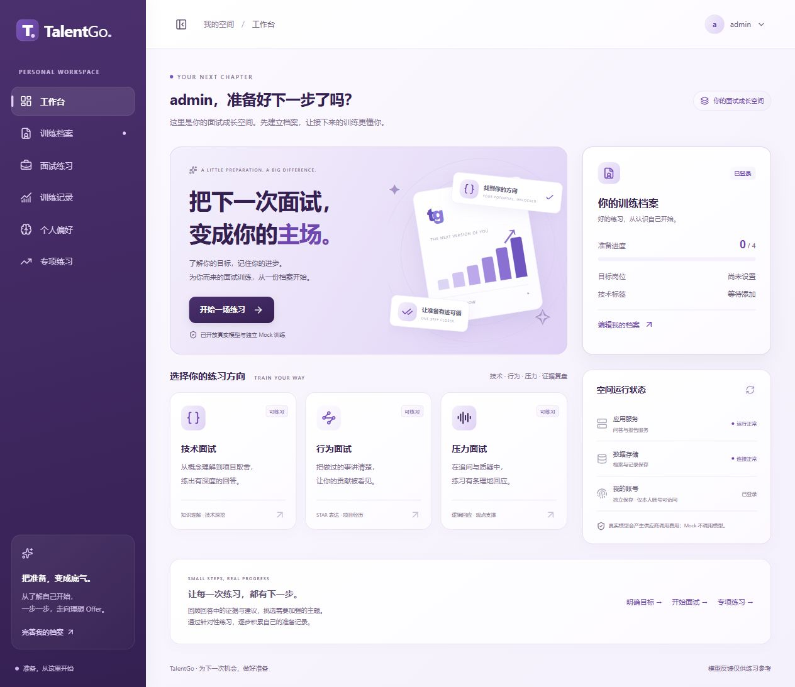
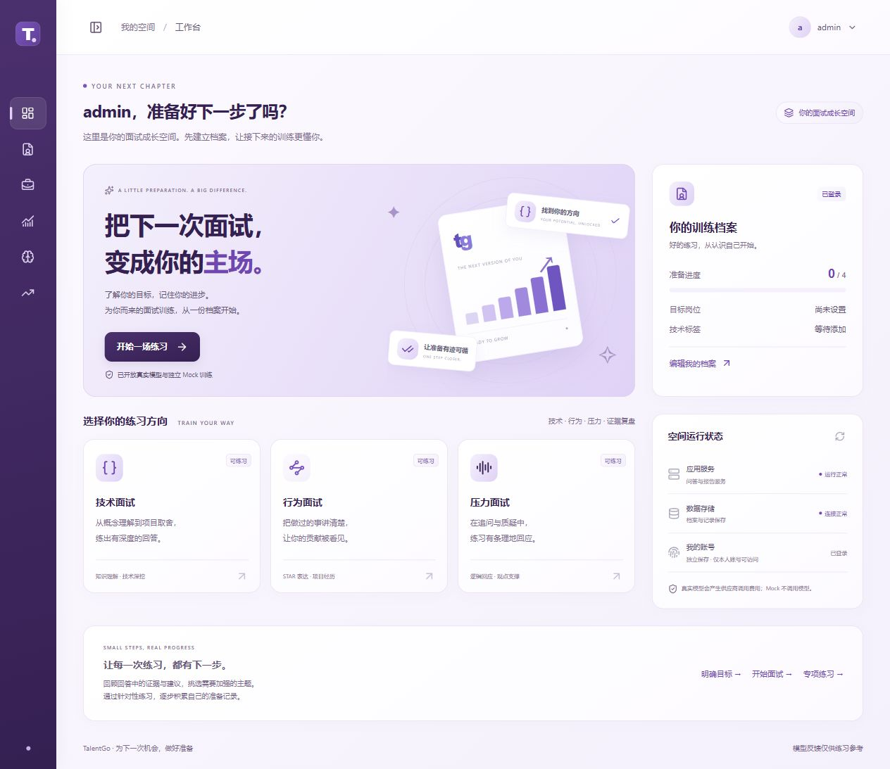
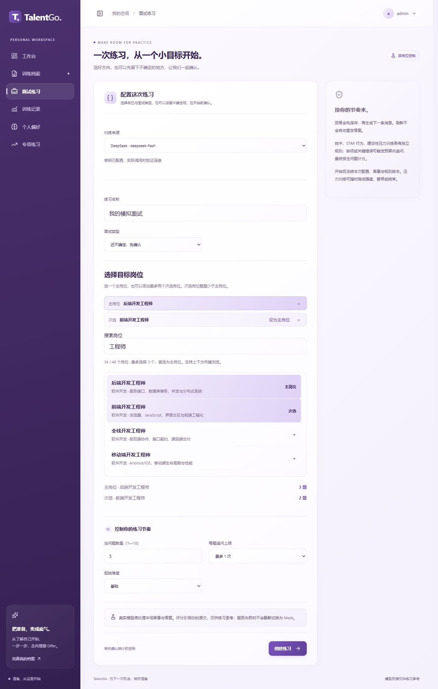

# PC 界面主题与交互调整

日期：2026-11-16。基于 v0.6.0 的界面增补，属于 M5 之后的产品修正，未进入 M6 真实用户验证。

## 1. 目标与覆盖

按用户要求，以白色到深紫色的五级渐变统一整个工作空间，保持简约和清晰的阅读层次。覆盖首页、训练档案、练习配置、训练记录、个人偏好、专项练习、面试室、报告，以及全局账号弹窗。错误与警告仍保留语义颜色，避免把错误与普通选中状态混淆。

本次只调整 PC 展示与交互，不新增移动端工作。API、数据库迁移、登录有效期、岗位目录、题量分配、模型提示词和评分规则沿用既有版本；没有安装动画库或其他新依赖。

## 2. 五级渐变规范

全站主题入口为 frontend/src/styles/theme.css，通过 main.ts 在基础布局样式之后加载。基础布局继续负责网格、间距和已有组件结构；主题层统一颜色、表面、阴影和动态反馈。报告和专项练习页的局部样式也改为读取共享变量。

| 层级 | 变量 | 渐变与用途 |
|---|---|---|
| 纸白 | --surface-paper | 白 → 极浅紫；内容卡片、输入框、顶栏、账号弹窗 |
| 雾紫 | --surface-mist | 极浅紫 → 雾紫；页面背景、说明区、次要操作 |
| 浅紫 | --surface-lavender | 雾紫 → 浅紫；首页主视觉、已选岗位、图标底色 |
| 紫罗兰 | --surface-violet | 紫罗兰 → 较深紫；主操作、进度、品牌标记 |
| 深紫 | --surface-deep | 深紫 → 更深紫；侧边栏和强调操作 |

五级指五套渐变表面，不限制整个页面只能出现五个颜色值。正文使用深紫，辅助说明使用灰紫；原先蓝、橙、绿色的装饰图标统一到紫色系。边框、圆角和阴影采用轻量样式，卡片保留足够留白。

## 3. 侧边栏

顶栏面包屑之前新增展开/折叠按钮。完整侧栏在普通 PC 宽度为 232px，较窄 PC 窗口适当收窄；折叠后固定为 80px 图标栏。Logo、六个导航入口和当前页指示仍可见，入口具有中文可访问名称与悬停标题。

展开时使用 520ms 的 cubic-bezier(.2, 1.4, .3, 1)：先快速展开，略超目标，再回落。关闭使用平稳收拢曲线。内容区的宽度和左边距使用同一时长及曲线，避免侧栏独自盖住内容。说明文字渐隐，底部说明卡同步收起；被隐藏卡片设置 inert 和 aria-hidden，防止键盘进入不可见链接。

折叠状态单独保存在浏览器 localStorage 的 talentgo.sidebar.collapsed，不属于账号画像，也不写入服务器。存储不可用时仍能切换，只是不保证刷新恢复。按钮提供 aria-controls 与 aria-expanded，支持键盘操作。切换不重建当前页面，不会清空正在填写的练习名称、搜索词或已选岗位。

## 4. 动效规则

| 操作 | 反馈 |
|---|---|
| 初次进入或切换页面 | 短淡出后，新内容在约 280—360ms 内淡入并轻移到位 |
| 悬停可点击练习卡/记录 | 轻微上移、边框与阴影加强 |
| 悬停导航/岗位 | 背景加强、轻微水平位移 |
| 悬停主按钮 | 轻抬、亮度与阴影增强 |
| 点击按钮或可点击卡片 | 短暂缩小，提供按压反馈 |
| 聚焦输入框 | 紫色边框与淡紫外环 |
| 新对话、岗位标签、错误提示出现 | 约 240ms 的淡入与轻移 |

路由动画包裹独立页面容器，保留多根节点页面和登录弹窗事件的正常传递；以路径为 key，同页查询参数变化不强制重建页面。退出动画中的旧内容禁用指针操作。根滚动槽固定保留，减少长短页面切换时的横向跳动。

系统 prefers-reduced-motion: reduce 开启时，取消动画、过渡与相关位移反馈，保留颜色和焦点提示。已检查实现规则，未改动用户的系统设置，也未将规则检查描述为各操作系统的实机验收。

## 5. 实际检查与范围

本轮使用本地开发服务与已有测试账号，通过浏览器检查实际页面，没有生成新模型问答、修改用户档案或创建虚构试用反馈。

| 检查 | 结果 |
|---|---|
| TypeScript 检查及 Vite 生产构建 | 通过 |
| 首页、档案、配置、记录、偏好、专项练习导航 | 正常进入，当前入口正确高亮 |
| 已有面试室与真实模型报告 | 原有 9 条消息、报告内容和 20 个维度证据区正常显示；无新增模型调用 |
| 岗位搜索及主次选择 | AI 与工程师关键词正常筛选，已选标签和题量分配正常 |
| 折叠过程中的输入 | 练习名称、已选岗位保留 |
| 稳态侧栏与内容边界 | 折叠后均为 80px，未发现重叠或横向溢出 |
| 刷新恢复与键盘展开 | 保留折叠状态，Enter 可以展开 |
| 1440×960、1024×768 PC 窗口 | 已检查，没有横向溢出 |
| 开发控制台 | 检查时未见 Vue 错误或警告 |

本轮未改动后端业务，没有重复运行上一轮 166 项后端工程测试，也不将上一轮测试数作为本轮执行结果。浏览器操作与截图均为开发代理验证，不代表真人试用。截图中的既有评分来自上轮已明确记录的合成练习，不能作为模型准确率或真实学生能力结论。

## 6. 本地展示

打开 http://127.0.0.1:5173/ 。若页面保留旧样式，请刷新。点击面包屑前的按钮即可体验收起和回弹展开。

