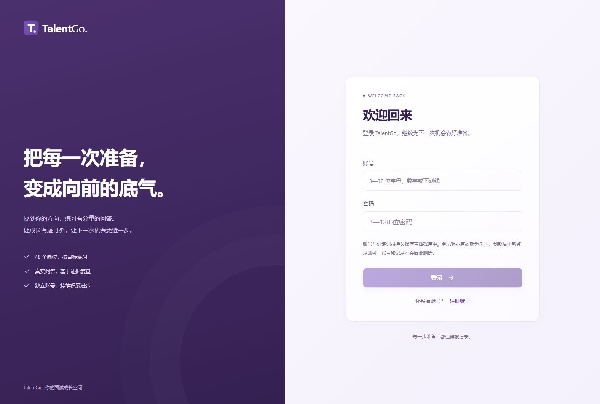
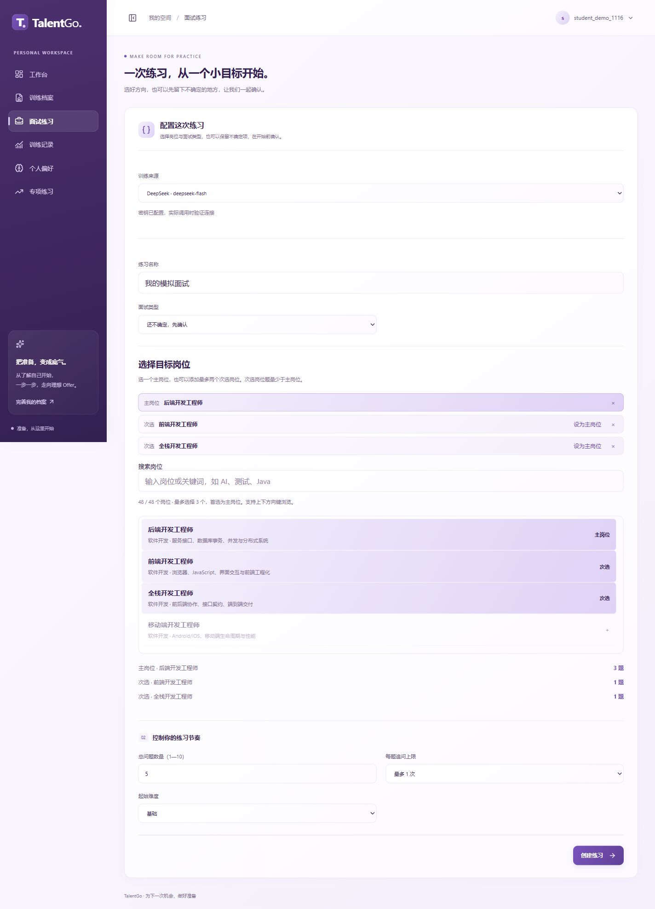

# 界面精简与次选岗位修复

日期：2026-11-18。应用仍为 v0.6.0，数据库 head=0006_profile_secondary_roles，端口 6543；未新增依赖，M6 真人验证未开展。

## 1. 截图需求逐项落实

| 截图 | 处理 |
|---|---|
| 1：深紫区域 YOUR NEXT CHAPTER | 删除登录/注册介绍区对应提示行及图标 |
| 2：账号大小写及公共电脑提醒 | 删除登录/注册表单底部对应组件 |
| 3：按你的节奏来 | 删除练习配置右侧整张说明卡 |
| 4：按岗位定制 | 删除练习页标题旁的标记 |
| 5：模型反馈仅供练习参考 | 删除全局页脚对应文字 |
| 6：纠正、删除 | 修改按钮文案为“修改”，两个操作均为独立按钮，高 34px、水平间距 20px；编辑标题同步为“修改这条记忆” |
| 7：真实模型处理画像与答案说明 | 删除练习配置底部这一来源提示条 |
| 8：将先确认缺少的目标 | 删除创建按钮旁的目标确认文字 |
| 9：你决定分享什么 | 删除档案侧栏分享说明与最近保存时间组件 |
| 10：个人账号卡片 | 删除档案侧栏整张身份卡 |

档案和练习配置均改为单列，避免删除侧栏后留下空位。删除操作仍保留原确认、版本检查和关联数据失效逻辑。异常提示、创建结果不确定时的恢复入口及压力训练主动同意没有删除。

## 2. 次选岗位问题和修复

排查确认：训练档案仍为单选，并且 Profile 原来只存 target_role；普通新建练习已有主次多选。用户从档案入口选择目标时只能得到主岗位，因此本轮让档案也支持一个主岗位、最多两个次选，并让新建普通练习自动带入保存的组合。

复用既有 RolePicker 的搜索、滚动、最大三项、设为主岗位和移除提升交互。个人偏好中的适用岗位仍为单选，来源专项练习仍限定来源岗位。常用档案与本场配置分别保存，调整档案不自动修改既有练习。

新增 profiles.secondary_roles JSONB 非空数组，迁移为旧档案补 []。API 返回该字段，保存时最多两个次选，拒绝未知岗位、重复、与主岗位相同、无主岗位和 null 数组。部分更新以请求与已有值的合并结果校验，不能通过只更新主岗位或只更新次选绕过限制。沿用资料行锁、版本控制、幂等以及记忆失效规则。

迁移从 0005_accounts_roles 增量升级，不重建表或数据卷；降级遇到非空次选列表会拒绝直接删除。仍为 16 张业务表，旧账号、档案和历史面试数据保留。

## 3. 验证结果

| 检查 | 实际结果 |
|---|---|
| 后端完整回归 | 178 项通过；保留一条既有 Starlette/httpx 弃用提示 |
| 前端认证测试 | 7 项通过 |
| Alembic check | 无新增升级操作、模型与数据库一致 |
| TypeScript 与 Vite 生产构建 | 通过 |
| 档案三选及数量上限 | PC 实际选择后端、前端、全栈；第四项禁用 |
| 资料保存与恢复 | 点击保存成功，刷新后三个岗位恢复 |
| 新建练习自动带入 | 三个岗位正确带入，五题预览为 3/1/1 |
| 主次交换及移除提升 | 前端设为主岗位成功；移除该主岗位后，后端自动提升为主岗位，全栈保留为次选 |
| 指定组件删除 | 登录页、练习页和档案页 DOM 检查通过；配置页未保留指定卡片、标记、说明条和目标文字 |
| 修改与删除按钮 | 两个真实 BUTTON 高 34px，间隔 20px；点击修改进入编辑、取消正常 |
| PC 布局与控制台 | 1440×960 检查未见横向溢出，检查时未见控制台错误或警告 |

新增后端用例覆盖档案默认空数组、保存重登、部分更新保留、非法主次组合、清空规则、用户隔离、旧练习不变和三岗位创建。浏览器使用既有专用开发测试账号，保存一条明确写明“开发自测”的合成偏好；没有改写用户 admin 的真实档案，没有新模型调用，也没有把这些操作计作真人试用。

完整回归首次发现既有记忆注入历史只按数据库时间排序，重试记录顺序不稳。已按操作对应会话版本、操作及 attempt_no 排序，保留时间和唯一 ID 作补充排序；在旧测试中显式构造重试时间倒置，保留“最新尝试使用新记忆版本”的断言。最终完整回归通过，未通过删断言掩盖失败。

## 4. 本地展示

打开 http://127.0.0.1:5173/ 。现有环境已升级数据库并更新后端；其他本地副本更新后先运行 Alembic upgrade head，再重启后端并刷新前端。登录后在“训练档案”选择主次岗位并保存，再进入“面试练习”查看带入结果。

个人偏好按钮的浏览器记录保存在 assets/streamlined-memory-actions.jpg；该全页截图从页面滚动位置捕获，固定侧栏位置随截图视口展示，按钮及表单内容为实际页面。
