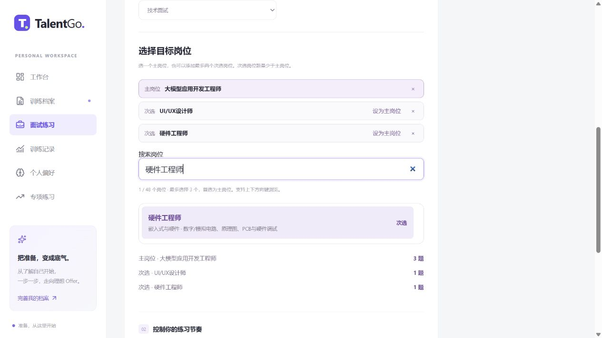
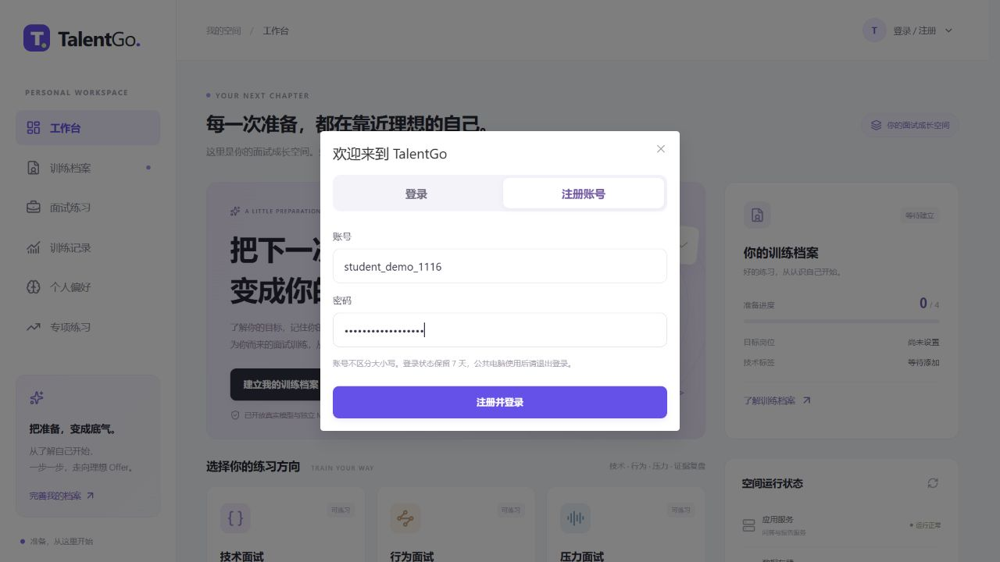
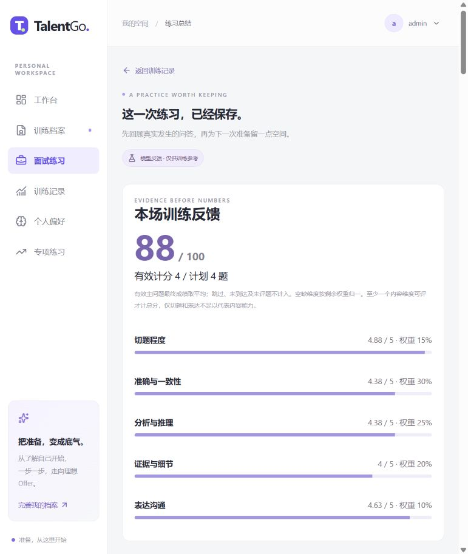

# TalentGo 账号与多岗位升级报告

日期：2026-11-16；应用 v0.6.0；Prompt prompt-1.3；评分 rubric-1.1；数据库 head 0005_accounts_roles，端口 6543。

## 1. 实现范围

本轮按新增需求补齐 PC 产品功能，不将其标成 M6 真人验证。已完成账号密码注册、登录、当前会话退出；本地普通测试账号 admin/password；完整 48 岗位目录、搜索与滚动列表；一个主岗位加最多两个次选；主次题量分配、实时模型问答评价、逐题岗位与后续任务归属；页面开发阶段用词清理，以及相关文档更新。

界面使用“个人偏好”“专项练习”等名称，移除侧栏和首页 M 阶段标记、开发架构路线图及验收介绍。新浏览器状态不再自动恢复历史匿名演示昵称，因此不会继续显示“M5 浏览器验收”。用户以前自行命名的数据库记录未被擅自改名或转移。

## 2. 账号设计与数据保留

注册与登录只填账号和密码。账号为 3—32 位 ASCII 字母/数字/下划线，不区分大小写；密码为 8—128 字符。密码使用独立盐的 PBKDF2-HMAC-SHA256（600000 次），库中保存不可直接使用的口令哈希。登录签发 7 天随机 token，库中只存 SHA256；退出撤销当前 token，其他设备保持登录。admin 不是超级管理员，无法读取其他用户资料。

迁移保留旧 users、profiles、会话与报告，增加可空账号字段和 auth_sessions，不删库或卷。历史 profiles 角色约束名称与 interview_sessions 不同，已按实际名称使用 op.f 修正；首次失败迁移由 PostgreSQL 事务回滚，随后升级成功。Alembic check 无结构漂移。

默认账号仅在 development 启动且 admin 不存在时建立，重复启动不重置密码、状态或资料。匿名创建 API 在正常环境返回 410；旧匿名凭证仍可访问自己的历史数据，新账号无法使用旧 token 绕过密码认证。旧记录不自动合并到新账号。回归用 test 环境保留历史创建夹具。

## 3. 48 个岗位与面试分配

完整目录保存在 backend/app/knowledge/roles.json，包含用户给出的 48 个岗位，覆盖开发、质量保障、数据、AI、安全、运维网络、硬件嵌入式、产品设计与架构方案。前端从 GET /roles 加载同一目录，不再将未知岗位误显示为后端。

用户输入中文岗位或英文关键词后实时筛选，列表可上下滚动和键盘浏览。已选项保留在列表上方，首次选择为主岗位，可添加两个次选、交换主次或移除；最多三项，第四项被禁用。移除主岗位会提升第一个次选。训练档案保存一个常用方向，本场次选独立于长期目标。

整场总题数仍为 1—10。双岗位至少 3 题、三岗位至少 4 题，确保主岗位多于每个次选。5 题三岗位为 3/1/1，4 题为 2/1/1，先问主岗位再问各次选。服务端创建、配置更新、开始动作均校验，不能通过部分更新绕过约束。切换岗位重置难度，防止把主岗位熟练程度套到次选。

新增岗位不建立逐岗固定题库，仅维护岗位能力范围和通用主题。真实模型生成具体问题和 2—6 条本题评价要点；内容冻结到题目快照。原前后端参考锚点和行为/压力规则保留兼容。模型参考锚点不等于专家审定标准；评价仍需逐字引用当前题答案，材料不足不造分。

每题保存实际岗位，提示、记忆筛选、评价、专项练习任务、报告和导出都使用该岗位。趋势按主次组合区分。整体分数依旧按有效最终题平均，不宣称仅靠一题测出完整次选岗位能力。

## 4. 工程验证

最终执行 `./scripts/check.ps1` 成功：

| 检查 | 实际结果 |
|---|---|
| 隔离 PostgreSQL 回归 | **166 passed**；开发库未用于清空式测试 |
| 新认证与岗位测试 | 24 项，涵盖注册、密码与 token 哈希、重复/错误凭证、长度边界、过期与撤销、独立账号、默认账号、48 岗位、错误配置、PATCH、跨岗位上下文与任务 |
| 模型适配器补充 | 修复提示说明 Schema 名和字段错误，不回显非法输入值；依旧最多一次受控修复 |
| 岗位难度与来源 | 新建多岗位受控流程的出题难度明确断言 1/2/1/1；评价、复盘、记忆与任务岗位不串用 |
| 数据库一致性 | Alembic head=0005_accounts_roles；check 无新操作 |
| PC 前端 | vue-tsc 与 Vite production build 通过 |

保留一个既有第三方警告：Starlette TestClient 提示 httpx 用法将弃用；本轮未新增依赖或升级该链路。工程测试使用受控 provider，不能据其分数声称真实模型准确率。

## 5. PC 实际操作与真实模型

实际通过右上角用 admin/password 登录，搜索 RAG、硬件工程师、UI/UX，配置三个岗位并验证第四项禁用、4 题 2/1/1 及 5 题 3/1/1 预览。列表实际滚动至末项可选；主次交换、移除后的自动提升均通过。独立 localhost 页面完成新账号注册、自动登录、无他人训练记录、刷新仍登录、退出及密码重登录。

使用已配置的 DeepSeek 运行一场真实合成练习，顺序为大模型应用、大模型应用、硬件、UI/UX。四题均得到有效最终评价和完整报告；程序复核 **21 处引用**确实来自本题用户答案，题目和最终评价均只有四条，无重试重复落库。练习总分 88 仅为该组合合成回答的模型结果，不是产品准确率、真实用户能力或课程得分。

现场联调还发现并修正了跨岗位沿用升高难度的问题。硬件题是在修正前生成，存量题未重写；UI/UX 在修正后以初始难度 1 生成。全新流程的 1/2/1/1 序列由工程测试另行核验，不混淆两类证据。

现场一次出题和初次整场复盘未通过严格结构校验，均保留答案并原操作重试一次后成功。最终复盘前增加简短输出要求、逐题岗位信息和按阶段说明的修复提示，原有 Schema、引用与一次修复上限未放宽。失败调用的用量未知，记录为未知，不补造 token 或费用。真实模型仍可能拒绝或输出不合规内容，可按页面原操作重试；不静默切换 Mock、不伪造报告。

原始合成报告、评价锚点、实际难度、失败与重试阶段见 [accounts-roles-live.json](assets/accounts-roles-live.json)，无密钥、登录凭证或真实个人材料。此过程由开发代理操作，**真实参与者为 0**，不能当作 M6 真人试用。

## 6. 文档与运行

README、完整项目开发计划、项目概况、架构、技术栈、接口、数据库、模块映射、评分、环境、启动、使用说明已同步。项目开发计划保留 M0—M6 的全部工作分解，并新增完整的本轮需求和验证任务。历史阶段文档与原始结果不重写，不恢复用户删除的不适用文档。

本地工作台：http://127.0.0.1:5173；配置 /practice；记录 /history；API http://127.0.0.1:8000/docs。旧页面需要刷新加载新版。前后端本地预览已启动。默认账号 admin/password 仅供本地测试，已有记录留在各自账号。

本轮结束后停止，M6 至少四名真实用户的实际参与和课程反馈仍未实施；未增加移动端、公开部署、找回密码、邮件验证或管理后台。
